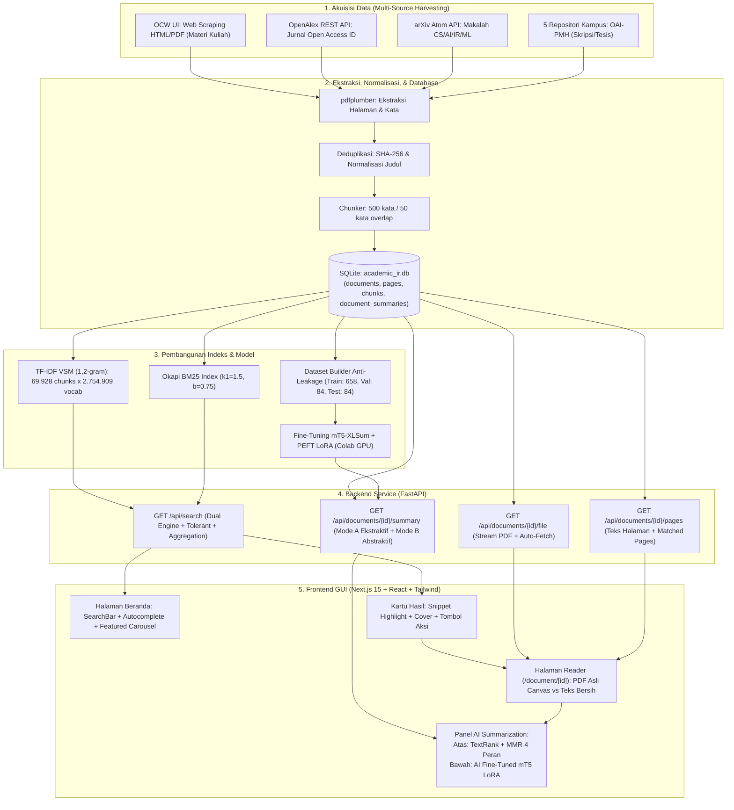
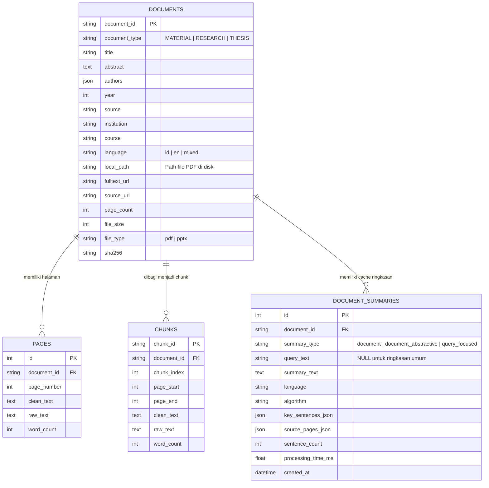
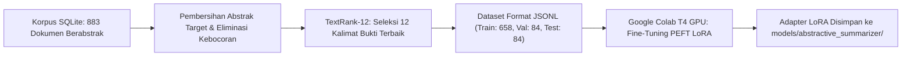

# Dokumentasi Komprehensif End-to-End: Dari Akuisisi Data Hingga Implementasi GUI

Dokumentasi ini menyajikan alur lengkap arsitektur sistem **Academic Information Retrieval (IR) & Dual-Mode Summarization**, mulai dari sumber data primer, metode ekstraksi, skema basis data, pemodelan mesin pencari dan AI ringkasan, hingga antarmuka pengguna grafis (*Graphical User Interface* / GUI).

---

## Daftar Isi
1. [Peta Alur Sistem (End-to-End Pipeline)](#1-peta-alur-sistem-end-to-end-pipeline)
2. [Tahap 1: Sumber Data & Prosedur Pengambilan (Data Harvesting)](#2-tahap-1-sumber-data--prosedur-pengambilan-data-harvesting)
3. [Tahap 2: Ekstraksi Teks, Normalisasi, & Skema Basis Data](#3-tahap-2-ekstraksi-teks-normalisasi--skema-basis-data)
4. [Tahap 3: Pemodelan Mesin Pencari & Retrieval Dokumen](#4-tahap-3-pemodelan-mesin-pencari--retrieval-dokumen)
5. [Tahap 4: Dataset Builder & Pelatihan AI Summarization (Fine-Tuning LoRA)](#5-tahap-4-dataset-builder--pelatihan-ai-summarization-fine-tuning-lora)
6. [Tahap 5: Arsitektur Backend API (FastAPI)](#6-tahap-5-arsitektur-backend-api-fastapi)
7. [Tahap 6: Implementasi Frontend GUI (Next.js 15 App Router)](#7-tahap-6-implementasi-frontend-gui-nextjs-15-app-router)
8. [Matriks Rujukan File Kunci](#8-matriks-rujukan-file-kunci)

---

## 1. Peta Alur Sistem (End-to-End Pipeline)



---

## 2. Tahap 1: Sumber Data & Prosedur Pengambilan (Data Harvesting)

Sistem mengumpulkan korpus akademik multi-disiplin dan bilingual (Indonesia & Inggris) dari empat saluran primer:

### 2.1. Materi Perkuliahan (`MATERIAL`) — OpenCourseWare UI
* **Sumber**: OpenCourseWare Universitas Indonesia ([https://ocw.ui.ac.id/](https://ocw.ui.ac.id/))
* **Kategori**: `category_id: 12` (mencakup Fakultas Ilmu Komputer, Teknik, Ekonomi dan Bisnis, FMIPA, Psikologi, Kedokteran, dll.).
* **Kode Kolektor**:
  * [academic-ir/src/collectors/ocw_ui.py](file:///c:/Users/Monk/Downloads/TemuKembaliInformasi/academic-ir/src/collectors/ocw_ui.py)
  * [academic-ir/scripts/collect_ocw.py](file:///c:/Users/Monk/Downloads/TemuKembaliInformasi/academic-ir/scripts/collect_ocw.py)
  * [academic-ir/scripts/collect_materials_all_prodi.py](file:///c:/Users/Monk/Downloads/TemuKembaliInformasi/academic-ir/scripts/collect_materials_all_prodi.py)
* **Metode Scraping**:
  1. Melakukan perayapan (*crawling*) struktur program studi dan mata kuliah.
  2. Mengekstrak tautan berkas bahan ajar (`.pdf`, `.pptx`, `.doc`).
  3. Mengunduh berkas dengan *rate limit* 2 detik dan timeout 30 detik.
* **Penyimpanan Berkas Mentah**:
  * Direktori: `academic-ir/data/raw/material/<Nama_Fakultas>/<Nama_Matakuliah>/`
  * Manifest: [academic-ir/data/manifests/material.jsonl](file:///c:/Users/Monk/Downloads/TemuKembaliInformasi/academic-ir/data/manifests/material.jsonl) (1.074 dokumen).

---

### 2.2. Artikel Jurnal Ilmiah Indonesia (`RESEARCH`) — OpenAlex REST API
* **Sumber**: OpenAlex Global Scholarly Graph API ([https://api.openalex.org/works](https://api.openalex.org/works))
* **Filter Permintaan API**:
  * `language:id` (Bahasa Indonesia)
  * `open_access.is_oa:true` (Akses Terbuka)
  * `has_abstract:true` (Wajib memiliki abstrak)
  * `type:article` (Artikel jurnal)
  * Bidang keilmuan: `topics.field.id:fields/17` (Computer Science), `fields/22` (Engineering), `fields/14` (Business/Management), `fields/33` (Social Sciences/Education).
* **Kode Kolektor**:
  * [academic-ir/src/collectors/openalex.py](file:///c:/Users/Monk/Downloads/TemuKembaliInformasi/academic-ir/src/collectors/openalex.py)
* **Penanganan Data Khusus**:
  * **Rekonstruksi Abstrak (`reconstruct_abstract`)**: OpenAlex menyimpan abstrak dalam bentuk kamus kata ke indeks posisi (`abstract_inverted_index`). Modul ini mengurutkan kembali pasangan `(posisi, kata)`, membersihkan entitas HTML, dan menghasilkan paragraf teks utuh.
  * **Unduhan PDF Paralel**: Menelusuri `best_oa_location.pdf_url` dari server OJS kampus asal (misalnya e-journal Undip, Telkom, UI, dll.), lalu mengunduhnya menggunakan `ThreadPoolExecutor` (default 6 thread).
* **Penyimpanan Berkas Mentah**:
  * Direktori: `academic-ir/data/raw/research/res_oa_id_<hash>.pdf`
  * Berkontribusi pada 300 artikel jurnal nasional bereputasi di basis data.

---

### 2.3. Makalah Penelitian Internasional (`RESEARCH`) — arXiv Atom API
* **Sumber**: arXiv API ([https://export.arxiv.org/api/query](https://export.arxiv.org/api/query))
* **Kategori yang Dipanen**:
  * `cat:cs.IR` (Information Retrieval)
  * `cat:cs.CL` (Computation and Language / NLP)
  * `cat:cs.LG` (Machine Learning)
  * `cat:cs.AI` (Artificial Intelligence)
  * `cat:cs.DB` (Databases)
  * `cat:cs.SE` (Software Engineering)
  * `cat:cs.CV` (Computer Vision)
  * `cat:cs.NI` (Networking)
  * `cat:cs.CR` (Cryptography & Security)
* **Kode Kolektor**:
  * [academic-ir/scripts/collect_arxiv.py](file:///c:/Users/Monk/Downloads/TemuKembaliInformasi/academic-ir/scripts/collect_arxiv.py)
* **Logika Pengambilan**:
  * Membaca umpan Atom XML secara paginasi (`batch_size = 50`).
  * Memvalidasi panjang abstrak (`>= 150` karakter) untuk mencegah metadata kosong.
  * Mengunduh PDF langsung dari `https://arxiv.org/pdf/<arxiv_id>.pdf`.
* **Penyimpanan Berkas Mentah**:
  * Direktori: `academic-ir/data/raw/research/arxiv_<id>.pdf` (413 makalah).

---

### 2.4. Skripsi & Tesis (`THESIS`) — OAI-PMH Repositori Kampus Indonesia
* **Sumber**: 5 Repositori Institusi Universitas di Indonesia via protokol OAI-PMH 2.0 (Dublin Core):
  1. Universitas Diponegoro (Undip): `http://eprints.undip.ac.id/cgi/oai2`
  2. UIN Maulana Malik Ibrahim Malang: `http://repository.uin-malang.ac.id/cgi/oai2`
  3. Universitas Airlangga (Unair): `https://repository.unair.ac.id/cgi/oai2`
  4. Institut Teknologi Sepuluh Nopember (ITS): `https://repository.its.ac.id/cgi/oai2`
  5. UIN Sunan Kalijaga Yogyakarta: `https://digilib.uin-suka.ac.id/cgi/oai2`
* **Kode Kolektor**:
  * [academic-ir/src/collectors/repository.py](file:///c:/Users/Monk/Downloads/TemuKembaliInformasi/academic-ir/src/collectors/repository.py)
* **Logika Heuristik Pengunduhan**:
  * Repositori kampus memuat banyak berkas per skripsi (sampul, lembar pengesahan, abstrak, bab 1-5).
  * Algoritma `_pick_best_pdf_url()` memberi skor positif terhadap nama berkas yang memuat petunjuk teks utama (`"full"`, `"naskah"`, `"tesis"`, `"skripsi"`, `"bab2"`, `"bab3"`, `"pembahasan"`) dan menolak berkas pendahuluan/administratif (`"cover"`, `"abstrak"`, `"lampiran"`).
  * Batas unduh maksimal: 20 MB per berkas.
  * Validasi kualitas: minimal 3 halaman fisik dan minimal 400 kata.
* **Penyimpanan Berkas Mentah**:
  * Direktori: `academic-ir/data/raw/thesis/thesis_<hash>.pdf` (167 dokumen skripsi/tesis).

---

### 2.5. Orkestrator Terpadu
Skrip [academic-ir/scripts/harvest_training_corpus.py](file:///c:/Users/Monk/Downloads/TemuKembaliInformasi/academic-ir/scripts/harvest_training_corpus.py) mengoordinasikan seluruh akuisisi di atas, memperbarui manifest gabungan ([unified_manifest.csv](file:///c:/Users/Monk/Downloads/TemuKembaliInformasi/academic-ir/data/manifests/unified_manifest.csv)), lalu memicu pembangunan dataset ringkasan dan re-indexing mesin pencari.

---

## 3. Tahap 2: Ekstraksi Teks, Normalisasi, & Skema Basis Data

### 3.1. Pipeline Ekstraksi PDF per Halaman
* File: [academic-ir/src/extraction/pdf.py](file:///c:/Users/Monk/Downloads/TemuKembaliInformasi/academic-ir/src/extraction/pdf.py)
* Menggunakan `pdfplumber` (dengan fallback `pypdf`) untuk mengekstrak teks **halaman demi halaman**.
* Setiap halaman mempertahankan atribut nomor halaman fisik (`page_number`), teks mentah (`raw_text`), teks bersih (`clean_text`), dan jumlah kata (`word_count`).

### 3.2. Deduplikasi Berkas & Rekor
* File: [academic-ir/src/dedup/hash.py](file:///c:/Users/Monk/Downloads/TemuKembaliInformasi/academic-ir/src/dedup/hash.py) & [academic-ir/src/collectors/base.py](file:///c:/Users/Monk/Downloads/TemuKembaliInformasi/academic-ir/src/collectors/base.py)
* Setiap berkas PDF dihitung hash SHA-256 miliknya. Jika hash sudah ada di basis data, berkas fisik baru segera dihapus dari disk untuk mencegah redundansi.
* Fungsi `normalize_title_key(title)` menormalkan variasi spasi, tanda baca, dan kapitalisasi judul untuk mencegah duplikasi lintas sumber.

### 3.3. Chunking Cerdas (Semantic Chunker)
* File: [academic-ir/src/indexing/chunker.py](file:///c:/Users/Monk/Downloads/TemuKembaliInformasi/academic-ir/src/indexing/chunker.py)
* Membagi teks halaman menjadi segmen chunk berukuran maksimal **500 kata** dengan tumpang tindih (*overlap*) **50 kata**.
* Menyimpan penanda `page_start` dan `page_end` pada setiap chunk agar hasil pencarian dapat ditelusuri ke halaman aslinya.

### 3.4. Skema Basis Data Relasional SQLite
Basis data utama tersimpan pada file lokal: `academic-ir/database/academic_ir.db` (diatur oleh [academic-ir/src/database/models.py](file:///c:/Users/Monk/Downloads/TemuKembaliInformasi/academic-ir/src/database/models.py)).



* **Statistik Basis Data Terkini**:
  * Total Dokumen: **1.960**
  * Dokumen dengan Berkas Lokal: **1.960** (100%)
  * Dokumen dengan Abstrak Lengkap: **885**
  * Total Halaman Fisik (`pages`): **59.056**
  * Total Unit Pencarian (`chunks`): **70.251**

---

## 4. Tahap 3: Pemodelan Mesin Pencari & Retrieval Dokumen

### 4.1. Mesin Pencari Dual-Engine (TF-IDF VSM & Okapi BM25)
Sistem mendukung dua algoritma pencarian teks pada level chunk:

1. **Vector Space Model (TF-IDF VSM)**:
   * File: [academic-ir/src/indexing/tfidf.py](file:///c:/Users/Monk/Downloads/TemuKembaliInformasi/academic-ir/src/indexing/tfidf.py)
   * Fitur: Unigram + Bigram `(1, 2)`, *sublinear term frequency scaling* ($1 + \ln(\text{tf})$), `min_df = 2`, `max_df = 0.95`.
   * Artefak Indeks Tersimpan di `academic-ir/models/`:
     * `tfidf_matrix.npz`: Matriks *sparse* berukuran **`69.928` baris x `2.754.909` kolom fitur** (94.92 MB).
     * `tfidf_vectorizer.pkl`: Objek *fitted vectorizer* scikit-learn (73.28 MB).
     * `chunk_ids.pkl`: Pemetaan indeks baris ke ID chunk unik (1.27 MB).
     * `index_metadata.json`: Metadata ukuran kamus dan matriks.
2. **Okapi BM25 Retriever**:
   * File: [academic-ir/src/retrieval/bm25.py](file:///c:/Users/Monk/Downloads/TemuKembaliInformasi/academic-ir/src/retrieval/bm25.py)
   * Parameter: $k_1 = 1.5, b = 0.75$.
   * Artefak Tersimpan: `academic-ir/models/bm25_v1/bm25_index.pkl` (377.96 MB).

### 4.2. Agregasi Chunk-ke-Dokumen (`aggregate_by_document`)
* File: [academic-ir/src/retrieval/aggregation.py](file:///c:/Users/Monk/Downloads/TemuKembaliInformasi/academic-ir/src/retrieval/aggregation.py)
* **Masalah**: Dokumen panjang (skripsi 100+ halaman) dapat menghasilkan 15 chunk berturut-turut yang mendominasi peringkat teratas.
* **Solusi**: Mesin pencari mengambil kandidat awal sebanyak `candidate_k = 500` chunk, lalu mengelompokkannya per `document_id`. Skor dokumen dihitung menggunakan strategi **`max+2nd`**:
$$\text{Score}(D) = S_{\text{chunk}, 1} + 0.3 \cdot S_{\text{chunk}, 2}$$
Setiap kartu hasil pencarian merangkum `best_page_start`, `best_page_end`, daftar `matched_pages`, dan snippet dari chunk berperingkat tertinggi.

### 4.3. Lapisan Toleransi Ejaan (*Tolerant Retrieval*)
* File: `academic-ir/src/retrieval/tolerant.py`
* Menerapkan koreksi saltik (*typo*) berbasis SymSpell/Levenshtein, ekspansi sinonim akademik bilingual ([synonym_dict_bilingual.json](file:///c:/Users/Monk/Downloads/TemuKembaliInformasi/academic-ir/data/synonym_dict_bilingual.json)), serta proteksi singkatan teknis ([protected_terms.json](file:///c:/Users/Monk/Downloads/TemuKembaliInformasi/academic-ir/data/protected_terms.json)).
* Beroperasi dengan strategi **Exact-First**: kueri asli dieksekusi terlebih dahulu. Jika menghasilkan hasil relevan, sistem tidak mengubah kueri. Jika hasil nihil, mesin secara otomatis beralih ke kueri toleran (*autocorrect fallback*) dan memberikan pesan *"Menampilkan hasil untuk: ... did you mean: ..."*.

---

## 5. Tahap 4: Dataset Builder & Pelatihan AI Summarization (Fine-Tuning LoRA)

Untuk menghasilkan ringkasan berbahasa alami yang mengalir (mengatasi kalimat ekstraktif yang terpotong-potong), dibangun model generatif **Extract-then-Abstract (Jalur A)**:



### 5.1. Dataset Anti-Leakage Builder
* File: [academic-ir/scripts/prepare_summarization_dataset.py](file:///c:/Users/Monk/Downloads/TemuKembaliInformasi/academic-ir/scripts/prepare_summarization_dataset.py)
* **Pembersihan Abstrak Target (`clean_target_abstract`)**: Menghilangkan awalan *"Abstract:"*, memisahkan abstrak bilingual Indonesia–Inggris yang menumpuk, dan memotong di batas kalimat hingga maksimal 220 kata.
* **Pencegahan Kebocoran (*Leakage Prevention*)**: Pada ratusan dokumen, abstrak diulang pada halaman 1 atau 2 PDF. Jika kalimat tersebut masuk ke dalam input, model hanya akan menyalin tanpa belajar merangkum. Skrip secara otomatis **menghapus 17.048 kalimat bocor** sebelum algoritma TextRank dijalankan.
* **Split Data**:
  * `train.jsonl`: **658** sampel
  * `val.jsonl`: **84** sampel
  * `test.jsonl`: **84** sampel
  * `materials_for_distillation.jsonl`: **130** dokumen slide tanpa abstrak (disiapkan untuk distilasi lanjutan).

### 5.2. Konfigurasi Pelatihan LoRA (Colab Notebook)
* Notebook: [academic-ir/notebooks/train_abstractive_summarizer_colab.ipynb](file:///c:/Users/Monk/Downloads/TemuKembaliInformasi/academic-ir/notebooks/train_abstractive_summarizer_colab.ipynb)
* Model Fondasi: `csebuetnlp/mT5_multilingual_XLSum` (585.940.224 parameter).
* Konfigurasi LoRA:
  * Rank ($r$): `16`
  * Alpha ($\alpha$): `32`
  * Target Modules: `["q", "k", "v", "o"]` (modul atensi)
  * Parameter Terlatih: **3.538.944** parameter (hanya **0,604%** dari total model).
  * Epoch: 5 | Batch size: 2 | Gradient accumulation: 8 | Learning rate: 3e-4.
* **Artefak Bobot Tersimpan**:
  * Seluruh artefak diunduh ke [academic-ir/models/abstractive_summarizer/](file:///c:/Users/Monk/Downloads/TemuKembaliInformasi/academic-ir/models/abstractive_summarizer/):
    * `adapter_model.safetensors` (13.54 MB)
    * `tokenizer.json` (15.57 MB)
    * `adapter_config.json`, `tokenizer_config.json`, `training_metadata.json`

### 5.3. Loader Inferensi & Guardrails Pasca-Proses
* File: [academic-ir/src/summarization/abstractive.py](file:///c:/Users/Monk/Downloads/TemuKembaliInformasi/academic-ir/src/summarization/abstractive.py)
* **Thread-Safety**: Menggunakan `threading.Lock()` dalam metode `is_ready()` agar pemanggilan paralel dari antarmuka web tidak memicu pemuatan ganda.
* **Decoding Guardrails**:
  * `num_beams = 4`, `no_repeat_ngram_size = 3`, `repetition_penalty = 1.18`, `min_length = 45`, `max_new_tokens = 200`.
  * `_trim_incomplete_sentence()`: Memangkas kalimat yang terhenti di tengah jalan akibat batas token.
  * `compute_grounding_score()`: Menghitung persentase kata konten hasil generasi yang benar-benar berasal dari bukti sumber (mencegah halusinasi).

---

## 6. Tahap 5: Arsitektur Backend API (FastAPI)

File Server: [academic-ir/app/api.py](file:///c:/Users/Monk/Downloads/TemuKembaliInformasi/academic-ir/app/api.py)  
Dijalankan via Uvicorn pada `http://127.0.0.1:8000`.

| Endpoint | Method | Parameter Utama | Deskripsi & Keluaran |
| :--- | :---: | :--- | :--- |
| `/api/search` | `GET` | `q`, `top_k`, `retrieval_mode`, `aggregation_strategy`, `tolerant_mode`, `document_type`, `language` | Menghasilkan daftar dokumen teragregasi beserta skor, snippet ber-highlight, nomor halaman terbaik, dan metadata toleransi kueri. |
| `/api/tolerant/suggest` | `GET` | `q`, `limit` | Menyajikan rekomendasi kata kunci (*autocomplete*) dan koreksi saltik saat pengguna mengetik di kotak pencarian. |
| `/api/documents/{id}` | `GET` | `document_id` | Mengembalikan metadata lengkap dokumen, status keberadaan berkas fisik (`has_file`), dan tautan berkas (`file_url`). |
| `/api/documents/{id}/pages` | `GET` | `document_id`, `q` | Mengambil seluruh teks halaman demi halaman, metadata jumlah kata, dan daftar `matched_pages` yang mengandung kata kunci kueri. |
| `/api/documents/{id}/file` | `GET/HEAD` | `document_id` | Mengalirkan berkas PDF asli langsung ke peramban (`Content-Disposition: inline`, `Accept-Ranges: bytes`). Jika berkas belum ada di disk, fungsi `_resolve_doc_file_path` akan mengunduhnya secara otomatis dari URL repositori/arXiv. |
| `/api/summarization/model-status`| `GET` | — | Memeriksa ketersediaan bobot model LoRA, dependensi inferensi CPU, dan statistik dataset tanpa memblokir server. |
| `/api/documents/{id}/summary` | `GET` | `document_id`, `mode` (`extractive`/`abstractive`), `max_sentences`, `force_refresh` | Menghasilkan ringkasan dokumen: **Mode A** (TextRank + MMR 4 peran terstruktur) atau **Mode B** (paragraf alami hasil model fine-tuned LoRA dengan *grounding score*). |
| `/api/documents/{id}/query-summary` | `POST` | `document_id`, payload JSON `{ query, max_sentences }` | Menghasilkan ringkasan relevan yang berfokus menjawab kueri spesifik pengguna melalui pencocokan *multilingual embedding*. |

---

## 7. Tahap 6: Implementasi Frontend GUI (Next.js 15 App Router)

Frontend dibangun menggunakan **Next.js 15 (App Router)**, **React 19**, **Tailwind CSS**, dan komponen UI dari **shadcn/ui**.

### 7.1. Antarmuka Kotak Pencarian & Autocomplete
* File: [academic-ir/academic-ir-frontend/src/components/search-bar.tsx](file:///c:/Users/Monk/Downloads/TemuKembaliInformasi/academic-ir/academic-ir-frontend/src/components/search-bar.tsx)
* Terhubung langsung dengan endpoint `/api/tolerant/suggest`. Saat pengguna mengetik minimal 1 karakter, muncul dropdown yang menyajikan saran pelengkapan kueri, rekomendasi *"Did you mean"*, dan koreksi saltik secara *real-time*.

### 7.2. Kartu Hasil Pencarian & Aksi Langsung
* File: [academic-ir/academic-ir-frontend/src/components/result-card.tsx](file:///c:/Users/Monk/Downloads/TemuKembaliInformasi/academic-ir/academic-ir-frontend/src/components/result-card.tsx)
* Setiap hasil pencarian menampilkan:
  * Desain sampul visual otomatis (*Swiss minimal journal cover*) via [academic-cover.tsx](file:///c:/Users/Monk/Downloads/TemuKembaliInformasi/academic-ir/academic-ir-frontend/src/components/covers/academic-cover.tsx).
  * Badge tipe dokumen (`MATERIAL`, `RESEARCH`, `THESIS`), badge institusi, tahun, dan bahasa.
  * Skor relevansi dan jumlah chunk yang cocok.
  * Snippet teks dengan penyorotan kata kueri.
  * **Tombol Aksi**:
    * **"Baca Dokumen Lengkap"**: Membuka halaman layar penuh `/document/[id]?q=...&page=...`.
    * **"Ringkasan"**: Membuka modal dialog [summary-dialog.tsx](file:///c:/Users/Monk/Downloads/TemuKembaliInformasi/academic-ir/academic-ir-frontend/src/components/summary-dialog.tsx).

---

### 7.3. Halaman Pembaca Dokumen Penuh (`/document/[id]`)
* File: [academic-ir/academic-ir-frontend/src/app/document/[id]/page.tsx](file:///c:/Users/Monk/Downloads/TemuKembaliInformasi/academic-ir/academic-ir-frontend/src/app/document/[id]/page.tsx)
* Menyediakan pengalaman membaca dokumen akademik tanpa batas modal dialog:
  * **Header Kontrol**: Tombol kembali, navigasi halaman `[ < Halaman X / Y > ]`, penyesuaian zoom (`75% - 200%`), tombol unduh berkas asli, dan tombol sakelar visibilitas panel AI.
  * **Pita Halaman Cocok Kueri (*Query Matched Strip*)**: Jika pembaca dibuka dari pencarian, muncul deretan tombol pintas `Hal. 3`, `Hal. 7`, dll., yang langsung melompat ke halaman tempat kueri ditemukan.
  * **Mode Tampilan Ganda**:
    1. **Mode PDF Asli (Canvas `react-pdf`)**:
       * Komponen: [academic-ir/academic-ir-frontend/src/components/pdf-viewer.tsx](file:///c:/Users/Monk/Downloads/TemuKembaliInformasi/academic-ir/academic-ir-frontend/src/components/pdf-viewer.tsx).
       * Merender berkas PDF fisik halaman per halaman menggunakan worker `pdfjs-dist`.
       * **Fallback Multi-Tingkat**: Jika peramban memblokir canvas PDF, komponen secara otomatis menawarkan opsi **Native Browser PDF (`<iframe>`)** dan tombol beralih ke **Transkrip Teks Bersih**.
    2. **Mode Teks Bersih (Clean Text Reader)**:
       * Merender teks transkrip terstruktur per halaman langsung dari basis data.
       * Kontrol ukuran teks (`A-`, `A`, `A+`), tombol salin teks halaman, dan penyorotan kata kueri.

---

### 7.4. Panel AI Summarization Bertumpuk (*Stacked Dual-Mode GUI*)
* File: [academic-ir/academic-ir-frontend/src/components/reader/document-summary-sidebar.tsx](file:///c:/Users/Monk/Downloads/TemuKembaliInformasi/academic-ir/academic-ir-frontend/src/components/reader/document-summary-sidebar.tsx) & [summary-dialog.tsx](file:///c:/Users/Monk/Downloads/TemuKembaliInformasi/academic-ir/academic-ir-frontend/src/components/summary-dialog.tsx)
* Kedua mode diletakkan secara vertikal dalam satu tampilan utuh tanpa toggle yang saling menghilangkan:

```
┌─────────────────────────────────────────────────────────────┐
│ TAB: [ Intisari ]  [ Kueri ]  [ Metadata ]                  │
├─────────────────────────────────────────────────────────────┤
│ 1. RINGKASAN EKSTRAKTIF (TEXTRANK + MMR)                    │
│    [Intisari Terstruktur (4 Poin)] [Kronologis]             │
│                                                             │
│    ┌─ [Topik Utama] ──────────────────────────────────┐     │
│    │  "Penelitian ini merancang sistem antrian..."   │     │
│    │                                        [Hal. 1]  │     │
│    └──────────────────────────────────────────────────┘     │
│    ┌─ [Konsep Penting] ───────────────────────────────┐     │
│    │  "CRM merupakan konsep manajemen relasi..."     │     │
│    │                                        [Hal. 2]  │     │
│    └──────────────────────────────────────────────────┘     │
│    ┌─ [Pembahasan] ───────────────────────────────────┐     │
│    │  "Sistem dikembangkan menggunakan metode UML..." │     │
│    │                                        [Hal. 3]  │     │
│    └──────────────────────────────────────────────────┘     │
│    ┌─ [Informasi Pendukung] ──────────────────────────┐     │
│    │  "Pengujian Black Box menunjukkan sistem valid." │     │
│    │                                        [Hal. 5]  │     │
│    └──────────────────────────────────────────────────┘     │
├─────────────────────────────────────────────────────────────┤
│ ────────────────────── (Separator) ──────────────────────── │
├─────────────────────────────────────────────────────────────┤
│ 2. AI ABSTRAKTIF (MODEL FINE-TUNED)                         │
│    Badge: [mT5_multilingual_XLSum + LoRA] [Grounding: 96%]  │
│    Status: [Cache / 13.2 ms]  [Perbarui] [Salin]            │
│                                                             │
│    ┌─ Prosa Bahasa Alami ─────────────────────────────┐     │
│    │  "Sebuah sistem aplikasi Antrian Cucian Mobil    │     │
│    │   Berbasis Website menggunakan Konsep CRM dan    │     │
│    │   Penerapan UML. Aplikasi ini digunakan untuk    │     │
│    │   merancang penjadwalan antrian cuci mobil..."   │     │
│    └──────────────────────────────────────────────────┘     │
│    Sumber Halaman: [Hal. 1] [Hal. 2] [Hal. 3] [Hal. 5]      │
└─────────────────────────────────────────────────────────────┘
```

* **Interaktivitas Terintegrasi**: Mengklik badge halaman `[Hal. X]` pada ringkasan ekstraktif maupun abstraktif akan secara otomatis menggerakkan penampil dokumen di sebelah kiri ke halaman fisik tersebut.

---

## 8. Matriks Rujukan File Kunci

| Modul & Komponen | Jalur Berkas Relatif | Tanggung Jawab Teknis Utama |
| :--- | :--- | :--- |
| **Kolektor OpenAlex** | `academic-ir/src/collectors/openalex.py` | Harvesting REST API OpenAlex, rekonstruksi inverted index abstrak, unduh PDF OJS. |
| **Kolektor arXiv** | `academic-ir/scripts/collect_arxiv.py` | Query Atom API arXiv 9 kategori CS, validasi abstrak, unduh berkas PDF. |
| **Kolektor Tesis OAI**| `academic-ir/src/collectors/repository.py` | Pemanenan OAI-PMH 5 kampus Indonesia, seleksi URL PDF naskah utama. |
| **Ekstraksi PDF** | `academic-ir/src/extraction/pdf.py` | Ekstraksi teks per halaman dengan `pdfplumber` dan pemetaan nomor halaman fisik. |
| **Skema Database** | `academic-ir/src/database/models.py` | Manajemen koneksi & tabel SQLite (`documents`, `pages`, `chunks`, `document_summaries`). |
| **Indeks TF-IDF** | `academic-ir/src/indexing/tfidf.py` | VSM unigram+bigram bersublinear TF, serialisasi matriks sparse dan vectorizer. |
| **Indeks BM25** | `academic-ir/src/retrieval/bm25.py` | Model peringkat probabilistik Okapi BM25 tingkat chunk. |
| **Agregasi Dokumen** | `academic-ir/src/retrieval/aggregation.py` | Pengelompokan chunk ke dokumen dan penghitungan skor teragregasi `max+2nd`. |
| **Dataset LoRA** | `academic-ir/scripts/prepare_summarization_dataset.py` | Pembersihan teks abstrak target dan penyaringan 17.048 kalimat bocor. |
| **Training Notebook**| `academic-ir/notebooks/train_abstractive_summarizer_colab.ipynb` | Pelatihan LoRA 5 epoch pada Google Colab GPU menggunakan PEFT. |
| **Inferensi Model LoRA**| `academic-ir/src/summarization/abstractive.py` | Lazy loader model, thread-safe inference lock, guardrails decoding, grounding score. |
| **TextRank & Peran** | `academic-ir/src/summarization/textrank.py` | PageRank kalimat berbasis graf TF-IDF dan heuristik 4 peran struktural akademik. |
| **MMR Selection** | `academic-ir/src/summarization/mmr.py` | Diversifikasi kalimat terpilih untuk meminimalkan redundansi informasi. |
| **Backend REST API** | `academic-ir/app/api.py` | Server FastAPI, routing `/api/search`, `/pages`, `/file`, `/summary`, `/model-status`. |
| **Halaman Reader** | `academic-ir/academic-ir-frontend/src/app/document/[id]/page.tsx` | Layout pembaca layar penuh, navigasi halaman, sinkronisasi token cocok kueri. |
| **Penampil PDF** | `academic-ir/academic-ir-frontend/src/components/pdf-viewer.tsx` | Penampil PDF canvas `react-pdf` dengan multi-level fallback ke iframe & teks bersih. |
| **Sidebar Ringkasan**| `academic-ir/academic-ir-frontend/src/components/reader/document-summary-sidebar.tsx` | Panel visual GUI bertumpuk (Mode A Ekstraktif di atas, Mode B Abstraktif di bawah). |
