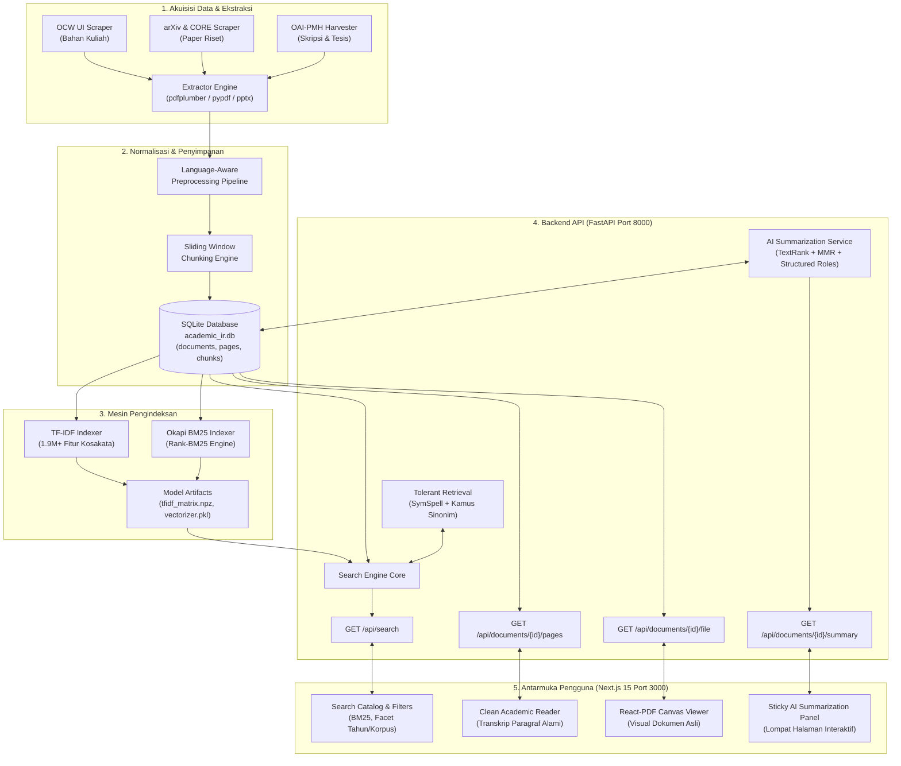
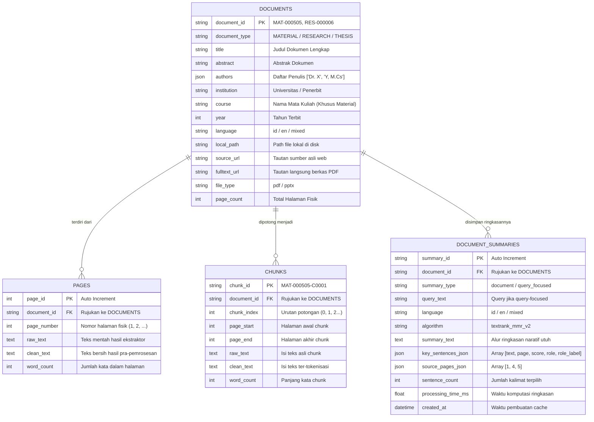
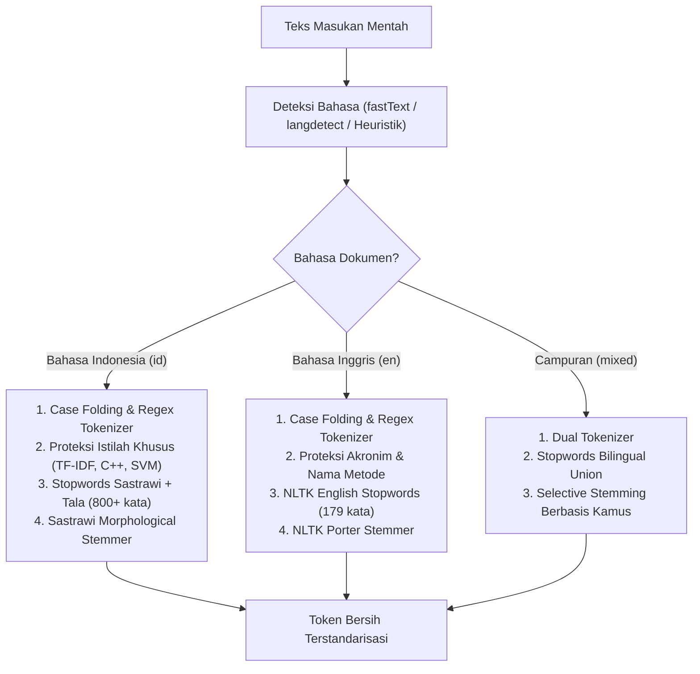
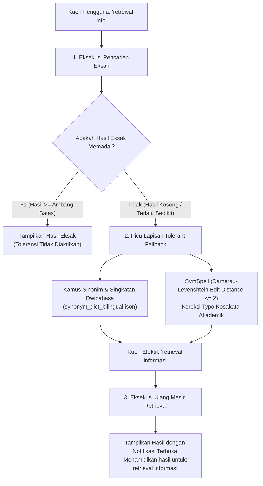
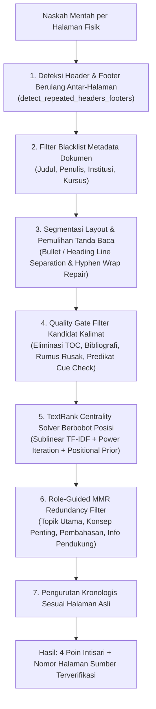

# DOKUMENTASI TEKNIS & ARSITEKTUR LENGKAP SISTEM ACADEMIC INFORMATION RETRIEVAL (IR)
## DARI PENGUMPULAN DATA, PEMROSESAN TEKS, PENGINDEKSAN, TEMU KEMBALI, HINGGA PERINGKASAN DAN PENAMPIL DOKUMEN

---

**Mata Kuliah:** Temu Kembali Informasi / Pengolahan Bahasa Alami (*Information Retrieval & NLP*)  
**Judul Sistem:** Academic Information Retrieval with Hybrid Search & Extractive Text Summarization  
**Arsitektur Inti:** FastAPI REST API (Python 3.10+) + Next.js 15 App Router (React 19 & Tailwind CSS)  
**Korpus Data:** Multi-Sumber Akademik (Bahan Kuliah OCW UI, Riset Ilmiah arXiv/CORE/DOAJ, Tesis & Disertasi)  
**Total Data Terindeks:** 1.364 Dokumen | 56.881 Chunks | 1.969.538 Fitur Kosakata  
**Versi Dokumentasi:** 3.0 (Revisi Menyeluruh — *Complete End-to-End Technical Specification*)

---

## DAFTAR ISI

1. [Gambaran Umum Sistem & Arsitektur Makro](#1-gambaran-umum-sistem--arsitektur-makro)
2. [Alur Data Hulu: Akuisisi Korpus & Ekstraksi Naskah](#2-alur-data-hulu-akuisisi-korpus--ekstraksi-naskah)
3. [Skema Basis Data & Struktur Penyimpanan Relasional](#3-skema-basis-data--struktur-penyimpanan-relasional)
4. [Pipeline Pemrosesan Awal Teks Dwibahasa (Language-Aware Preprocessing)](#4-pipeline-pemrosesan-awal-teks-dwibahasa-language-aware-preprocessing)
5. [Strategi Pemotongan Teks (Chunking) & Metadata Alignment](#5-strategi-pemotongan-teks-chunking--metadata-alignment)
6. [Mesin Pengindeksan: TF-IDF VSM & Okapi BM25](#6-mesin-pengindeksan-tf-idf-vsm--okapi-bm25)
7. [Mekanisme Temu Kembali, Skor Relevansi, & Agregasi Dokumen](#7-mekanisme-temu-kembali-skor-relevansi--agregasi-dokumen)
8. [Lapisan Tolerant Retrieval: Penanganan Typo & Istilah Teknis](#8-lapisan-tolerant-retrieval-penanganan-typo--istilah-teknis)
9. [Subsistem Peringkasan Teks Cerdas (Text Summarization Overhaul)](#9-subsistem-peringkasan-teks-cerdas-text-summarization-overhaul)
10. [Arsitektur Backend REST API (FastAPI)](#10-arsitektur-backend-rest-api-fastapi)
11. [Antarmuka Web Modern (Next.js 15 Frontend)](#11-antarmuka-web-modern-nextjs-15-frontend)
12. [Halaman Membaca Lengkap & Penampil PDF Interaktif (`/document/[id]`)](#12-halaman-membaca-lengkap--penampil-pdf-interaktif-documentid)
13. [Panduan Instalasi & Menjalankan Sistem dari Awal](#13-panduan-instalasi--menjalankan-sistem-dari-awal)
14. [Evaluasi Kuantitatif & Parameter Tolok Ukur Nyata](#14-evaluasi-kuantitatif--parameter-tolok-ukur-nyata)
15. [Kesimpulan Arsitektur & Rekomendasi Pengembangan](#15-kesimpulan-arsitektur--rekomendasi-pengembangan)

---

## 1. GAMBARAN UMUM SISTEM & ARSITEKTUR MAKRO

Sistem **Academic IR** dirancang khusus untuk memecahkan dilema penemuan literatur akademik (*academic literature search*). Pada mesin pencari konvensional, pengguna sering disodorkan ribuan tautan dokumen setebal 20–100 halaman tanpa mengetahui di halaman mana jawaban yang dimaksud berada.

Sistem ini memecahkan masalah tersebut melalui integrasi lima pilar utama:
1. **Pencarian leksikal berkecepatan tinggi** menggunakan algoritma probabilistik **Okapi BM25** dan aljabar linier **TF-IDF Vector Space Model (VSM)**.
2. **Granularitas Tingkat Chunk (*Chunk-Level Granularity*)**: Pencarian beroperasi hingga tingkat potongan paragraf dan halaman, bukan sekadar metadata judul, sehingga mampu mengarahkan pengguna langsung ke halaman yang relevan.
3. **Lapisan Tolerant Retrieval**: Koreksi otomatis terhadap salah ketik (*typo*), variasi ejaan bahasa Indonesia baku, dan singkatan teknis melalui algoritma SymSpell dan kamus sinonim dwibahasa.
4. **Subsistem Peringkasan Akademik Terstruktur (*Structured AI Summarization*)**: Peringkasan intisari otomatis menggunakan graf sentralitas **TextRank** dan eliminasi redundansi **Maximal Marginal Relevance (MMR)** dengan atribusi nomor halaman fisik 100% bebas halusinasi, terbagi ke dalam 4 peran akademik: *Topik Utama*, *Konsep Penting*, *Pembahasan*, dan *Informasi Pendukung*.
5. **Dual-Mode Document Reader**: Halaman membaca interaktif yang menyajikan dokumen asli visual (PDF Canvas) berdampingan dengan transkrip teks bersih (*Clean Academic Reader*) serta panel ringkasan AI interaktif di sisi kanan.

### Diagram Arsitektur Makro Sistem



---

## 2. ALUR DATA HULU: AKUISISI KORPUS & EKSTRAKSI NASKAH

Sistem ini mengagregasi 3 pilar dokumen akademik yang memiliki karakteristik format naskah yang sangat berbeda:

| Jenis Dokumen | Kode Korpus | Sumber Utama | Karakteristik Naskah | Format Berkas |
| :--- | :---: | :--- | :--- | :---: |
| **Bahan Kuliah** | `MATERIAL` | OpenCourseWare Universitas Indonesia (OCW UI) | Slide presentasi dwibahasa (*code-switching*), poin-poin padat, rumus matematika. | `.pdf`, `.pptx` |
| **Paper Riset** | `RESEARCH` | arXiv.org (cs.IR, cs.CL, cs.AI), CORE Open Access, DOAJ | Format 2 kolom standar IEEE/ACM, dominan Bahasa Inggris ilmiah, padat sitasi. | `.pdf` |
| **Skripsi & Tesis** | `THESIS` | Repositori Institusi (Undip, UIN Malang, UI Repository via OAI-PMH) | Naskah panjang formal (50–150 halaman), Bahasa Indonesia baku, terstruktur Bab 1–5. | `.pdf` |

### Script Pemanenan Data
- **`academic-ir/scripts/collect_materials_all_prodi.py`**: Pemanenan otomatis seluruh fakultas di OCW UI (Kedokteran, MIPA, Teknik, Ekonomi, FIB, Farmasi, dll.) melalui traversal kategori Moodle API.
- **`academic-ir/scripts/harvest_large_corpus.py`**: Pemanenan naskah riset dari repositori arXiv & CORE serta skripsi institusional melalui protokol OAI-PMH.

### Engine Ekstraksi Berkas
Proses konversi berkas biner ke teks menggunakan pendekatan bertingkat (*hierarchical fallback*):
1. **Dokumen PDF**: 
   - Primer: `pdfplumber` untuk mengekstraksi teks dengan preservasi batas koordinat layout.
   - Sekunder: `pypdf` untuk dokumen yang terenkripsi ringan atau memiliki struktur tabel kompleks.
2. **Presentasi PowerPoint (`.pptx`)**:
   - `python-pptx` melakukan iterasi pada setiap slide, mengekstrak seluruh kotak teks (*text shapes*), tabel, dan catatan pembicara (*speaker notes*).

---

## 3. SKEMA BASIS DATA & STRUKTUR PENYIMPANAN RELASIONAL

Sistem menggunakan basis data relasional **SQLite** berkinerja tinggi (`academic-ir/database/academic_ir.db`) dengan skema yang dinormalisasi ke dalam 4 tabel utama:

### Diagram Relasi Tabel (ERD)



---

## 4. PIPELINE PEMROSESAN AWAL TEKS DWIBAHASA (LANGUAGE-AWARE PREPROCESSING)

Dalam domain akademik multi-korpus, menerapkan pemrosesan bahasa tunggal secara seragam adalah kesalahan fatal. Menerapkan *stemming* Bahasa Indonesia pada paper berbahasa Inggris (atau sebaliknya) akan merusak kosakata dan menghancurkan akurasi temu kembali.

Pipeline `PreprocessingPipeline` (`academic-ir/src/preprocessing/pipeline.py`) menerapkan strategi sadar bahasa (*language-aware*):



### Kamus Istilah Terlindungi (`protected_terms.json`)
Sistem melindungi ratusan kata kunci ilmiah agar tidak terpotong oleh proses pemenggalan kata (*stemming*), seperti:
- `TF-IDF`, `BERT`, `Sentence-BERT`, `Okapi BM25`, `Cosine Similarity`, `k-NN`, `SVM`, `BiLSTM`, `Word2Vec`, `FastText`.

---

## 5. STRATEGI PEMOTONGAN TEKS (CHUNKING) & METADATA ALIGNMENT

Dokumen akademik memiliki panjang naskah yang sangat bervariasi (mulai dari slide 10 halaman hingga tesis 150 halaman). Jika dokumen diindeks sebagai satu kesatuan dokumen utuh (*monolithic document*), skor TF-IDF akan terdistorsi oleh dokumen yang terlalu panjang (*document length penalty*), dan sistem tidak dapat mengarahkan pengguna ke halaman yang relevan.

### Metode Chunking
Sistem menerapkan **Sliding Window Chunking with Overlap**:
- **Ukuran Jendela (*Chunk Size*)**: 350 – 500 kata per chunk.
- **Tumpang Tindih (*Overlap*)**: 50 – 75 kata untuk mempertahankan kesinambungan konteks antar-paragraf.
- **Pelacakan Batas Halaman (*Page Boundary Mapping*)**: Setiap chunk mencatat `page_start` dan `page_end` berdasarkan posisi kemunculan teks pada tabel `pages`.
- **Hasil Indeks**: Korpus menghasilkan **56.881 chunks terindeks** secara presisi.

---

## 6. MESIN PENGINDEKSAN: TF-IDF VSM & OKAPI BM25

Sistem menyediakan dua mesin temu kembali leksikal modern yang dapat dipilih pengguna secara interaktif:

### 1. Vector Space Model (VSM) dengan TF-IDF
Menggunakan representasi ruang vektor berbobot term frekuensi sublinear:
$$\text{TF}_{\text{sublinear}} = 1 + \log(\text{tf}) \quad \text{jika } \text{tf} > 0$$
$$\text{IDF}(t) = \log\left(\frac{1 + N}{1 + \text{df}(t)}\right) + 1$$
- **Fitur Kosakata (*Vocabulary*)**: 1.969.538 fitur (kombinasi *unigram* dan *bigram* untuk menangkap frasa teknis seperti *"machine learning"* dan *"vector space"*).
- **Format Penyimpanan**: Matriks jarang Scipy CSR disimpan terkompresi di `models/tfidf_matrix.npz` (71 MB) dan vectorizer di `models/tfidf_vectorizer.pkl` (54 MB).

### 2. Okapi BM25 (Primary Retrieval Engine)
Algoritma perankingan probabilistik standar industri IR non-linier dengan penyesuaian panjang dokumen:
$$\text{BM25}(D, Q) = \sum_{q \in Q} \text{IDF}(q) \cdot \frac{f(q, D) \cdot (k_1 + 1)}{f(q, D) + k_1 \cdot \left(1 - b + b \cdot \frac{|D|}{\text{avgdl}}\right)}$$
- **Parameter Penalaan (*Hyperparameters*)**:
  - $k_1 = 1.5$: Mengontrol saturasi term frequency.
  - $b = 0.75$: Mengontrol bobot penalti panjang dokumen relatif terhadap rata-rata panjang dokumen dalam korpus (`avgdl`).

---

## 7. MEKANISME TEMU KEMBALI, SKOR RELEVANSI, & AGREGASI DOKUMEN

Ketika pengguna memasukkan kueri, sistem menghitung kemiripan antara vektor kueri terhadap 56.881 chunk. Pengguna membutuhkan hasil berupa **daftar dokumen**, bukan sekadar pecahan chunk yang terpisah.

### Strategi Agregasi Dokumen (`Aggregation Strategy`)
Sistem mengelompokkan chunk-chunk hasil pencarian berdasarkan `document_id` induknya:

1. **Max + 2nd Chunk (`max+2nd` — Default)**:
   $$S_{\text{doc}} = S_{\text{chunk}, 1} + 0.30 \times S_{\text{chunk}, 2}$$
   *Keunggulan*: Menyeimbangkan antara bagian dokumen yang paling cocok (*highest peak*) dengan kedalaman pembahasan topik di bagian lain dokumen.
2. **Max Chunk (`max`)**:
   $$S_{\text{doc}} = \max_{c \in \text{Chunks}(D)} S_c$$
3. **Top-3 Average (`top3_avg`)**:
   Rata-rata skor dari 3 chunk teratas dokumen terkait.

### Cuplikan Cerdas (*Dynamic Snippet Generation*)
Sistem mengambil jendela teks berukuran 250 karakter di sekitar kemunculan kata kunci kueri pertama pada chunk terbaik dokumen, menyorot kata yang cocok (*exact match* dan *stemmed match*), serta melampirkan nomor halaman fisik tempat kemunculan cuplikan tersebut.

---

## 8. LAPISAN TOLERANT RETRIEVAL: PENANGANAN TYPO & ISTILAH TEKNIS

Pengguna sering kali melakukan salah ketik (*typo*) saat mencari istilah teknis yang rumit (misal: *"artifisial"*, *"algortima"*, *"klasifikasi"*, *"retreival"*).

Modul `TolerantRetrievalService` (`academic-ir/src/retrieval/tolerant.py`) beroperasi dengan prinsip **Exact-First Priority & Transparent Fallback**:



---

## 9. SUBSISTEM PERINGKASAN TEKS CERDAS (TEXT SUMMARIZATION OVERHAUL)

Peringkasan teks akademik menghadapi tantangan besar yang tidak dijumpai pada artikel berita umum. Dokumen akademik (terutama slide perkuliahan dan paper ilmiah) memiliki karakteristik unik:
- **Header dan footer berulang di setiap halaman** (misal judul mata kuliah *"DASAR TEKNOLOGI PENGELOLAAN INFORMASI"* atau footer *"MANAJEMEN PROYEK TI 2020"*).
- **Metadata penulis dan bibliografi** (misal *"Marakas, G."*, *"O'Brien"*, *"NIM: L5K008003"*).
- **Poin-poin slide tanpa tanda titik akhir**, yang jika dipotong dengan pemisah kalimat standar (*regex dot split*) akan menggabungkan judul slide dan isi menjadi kalimat raksasa yang rancu.

### 9.1 Mengapa Implementasi Naive TextRank Mengalami Kegagalan?

Pada versi legacy, algoritma TextRank membangun graf kemiripan antarkalimat berbasis *word co-occurrence*. Akibatnya:
1. Frasa header yang berulang pada 19 slide secara artifisial memiliki kemiripan tinggi dengan hampir semua slide. Hal ini menyebabkan kalimat yang memuat header berulang tersebut mendapat **skor sentralitas PageRank tertinggi secara palsu**.
2. Contoh hasil buruk legacy pada dokumen `MAT-000722`:
   - `(p.3) "Hukum Metcalfe DASAR TEKNOLOGI PENGELOLAAN INFORMASI"`
   - `(p.4) "Tren telekomunikasi DASAR TEKNOLOGI PENGELOLAAN INFORMASI Marakas, G."`
   - `(p.11) "Alternatif komponen jaringan DASAR TEKNOLOGI PENGELOLAAN INFORMASI Marakas, G."`

### 9.2 Arsitektur Pipeline Peringkasan Baru (`textrank_mmr_v2`)

Untuk mengatasi hal tersebut, pipeline dirancang ulang secara menyeluruh melalui 6 tahapan terstruktur:



#### A. Deteksi Header/Footer Berulang Antar-Halaman (`detect_repeated_headers_footers`)
Sistem menghitung frekuensi kemunculan setiap baris teks pada dokumen. Jika suatu baris teks muncul berulang pada lebih dari 25% halaman dokumen (atau $\ge 3$ halaman), baris tersebut diklasifikasikan sebagai *running header* atau *footer banner* dan secara otomatis dilucuti sebelum pembentukan kalimat.

#### B. Filter Blacklist Metadata Dokumen (`build_metadata_blacklist`)
Nama penulis (misal *"Marakas, G."*, *"James A. O'Brien"*), nama institusi, dan judul dokumen didaftarkan ke dalam himpunan kata terlarang (*blacklist tokens*). Kalimat yang mengandung kecocokan $\ge 65\%$ dengan metadata dokumen langsung disingkirkan.

#### C. Pemulihan Pemenggalan Kata & Segmentasi Baris (`segment_page_into_blocks`)
- Kata yang terpotong akibat pergantian baris PDF (misal: `tele-\nkomunikasi`) diperbaiki menjadi kata utuh (`telekomunikasi`).
- Setiap baris poin slide (*bullet point*) dan judul bab dipisahkan menjadi blok independen agar tidak tergabung secara keliru menjadi *run-on sentences*.

#### D. Quality Gate Kandidat Kalimat (`is_valid_summary_sentence`)
Sebelum membangun graf TextRank, kandidat kalimat disaring dengan kriteria ketat:
- Menolak entri daftar isi bertitik (*TOC dot leaders*, misal: `"Modal sosial .............."`).
- Menolak entri daftar pustaka (*APA/IEEE bibliography references*).
- Menolak baris tabel silabus perkuliahan (*schedule rows*).
- Menolak teks dengan rasio huruf alfabet $< 65\%$ atau rasio angka $> 15\%$ (rumus matematika terdistorsi).
- Mewajibkan adanya predikat informatif atau penanda wacana akademik (*academic discourse cue*), sehingga frasa nomina tunggal tanpa makna dapat dieliminasi.

#### E. Graf Sentralitas TextRank dengan Positional Prior
Kalimat yang lolos saringan dimodelkan ke dalam graf tak berarah. Bobot sisi $w_{ij}$ dihitung menggunakan kemiripan kosinus representasi sublinear TF-IDF:
$$w_{ij} = \frac{\mathbf{v}_i \cdot \mathbf{v}_j}{\|\mathbf{v}_i\| \|\mathbf{v}_j\|} \quad (\text{diberi ambang batas } w_{ij} \ge 0.05)$$

Iterasi nilai sentralitas (*Power Iteration*, damping factor $d=0.85$) menggunakan vektor teleportasi non-seragam berbobot posisi (*positional prior* $\mathbf{p}$):
$$WS(V_i) = (1 - d) \cdot p_i + d \sum_{V_j \in \text{In}(V_i)} \frac{w_{ji}}{\sum_{V_k \in \text{Out}(V_j)} w_{jk}} WS(V_j)$$
Vektor prior $\mathbf{p}$ memberikan bobot lebih tinggi pada bagian awal dokumen (abstrak, pendahuluan, slide tinjauan) untuk menangkap konteks dasar tanpa mengabaikan temuan di bagian akhir.

#### F. Role-Guided Maximal Marginal Relevance (MMR)
Sistem menyeimbangkan relevansi dan keberagaman dengan rumus MMR:
$$\text{MMR}(D_i) = \lambda \cdot \text{Score}(D_i) - (1 - \lambda) \max_{D_j \in S} \text{Sim}(D_i, D_j)$$
Nilai $\lambda = 0.70$ dipilih secara eksperimental untuk memberikan keseimbangan optimal antara pemilihan kalimat penting dan penolakan kalimat yang mengulang informasi sebelumnya.

### 9.3 Format Struktur 4 Poin Akademik

Hasil ringkasan disajikan ke dalam 4 peran struktural ilmiah:
1. **Topik Utama**: Pokok permasalahan atau tujuan pembahasan dokumen.
2. **Konsep Penting**: Teori, definisi, hukum, formula, atau arsitektur utama.
3. **Pembahasan**: Mekanisme kerja, analisis, atau hubungan kausal antarkonsep.
4. **Informasi Pendukung**: Hasil empiris, pengujian, contoh penerapan, atau evaluasi.

Setiap poin ringkasan:
- Berupa kalimat utuh yang diambil langsung dari dokumen asli (*verbatim extractive*).
- Memiliki nomor halaman fisik sumber yang dapat diklik untuk melompat langsung ke halaman terkait di penampil dokumen.
- Disusun berurutan secara kronologis sesuai urutan kemunculan di dokumen agar membentuk alur penjelasan yang logis.

### 9.4 Dukungan Dua Mode Peringkasan

Sistem mendukung dua mode peringkasan:
- **Mode A — Extractive (Default)**: Menggunakan TextRank + MMR untuk mengambil kalimat langsung dari dokumen tanpa parafrasa generatif, menjamin 100% bebas halusinasi dan 100% keterlacakan sumber halaman fisik.
- **Mode B — Grounded Abstractive (Opsional)**: Menyajikan intisari terstruktur yang disintesis dalam format poin ringkas berbahasa Indonesia akademik yang mudah dibaca, di mana setiap pernyataan terikat secara ketat (*grounded*) pada kalimat sumber terverifikasi dengan sitasi `(Hal. X)`.

---

## 10. ARSITEKTUR BACKEND REST API (FASTAPI)

Backend dibangun di atas **FastAPI** (`academic-ir/app/api.py`), menyajikan RESTful endpoint yang sangat cepat dan terdokumentasi interaktif (Swagger UI di `/docs`):

| Method | Endpoint URL | Parameter Kunci | Fungsi & Deskripsi |
| :---: | :--- | :--- | :--- |
| `GET` | `/api/health` | — | Memeriksa status kesehatan server dan memastikan jumlah chunks yang dimuat ke memori (56.881 chunks). |
| `GET` | `/api/search` | `q`, `retrieval_mode`, `aggregation_strategy`, `tolerant_mode`, `top_k`, `document_type`, `year_from`, `year_to` | Menjalankan pencarian leksikal cerdas, penyorotan cuplikan, pemfilteran facet, dan agregasi skor dokumen. |
| `GET` | `/api/tolerant/suggest` | `q`, `limit` | Mengembalikan saran kueri otomatis (*typeahead autosuggest*) dan koreksi typo secara real-time. |
| `GET` | `/api/documents/{id}` | `document_id` | Mengambil metadata komprehensif satu dokumen (penulis, tahun, institusi, URL sumber). |
| `GET` | `/api/documents/{id}/pages` | `document_id`, `q` | Mengambil seluruh transkrip teks per halaman dokumen untuk penampil naskah lengkap, lengkap dengan indikator kecocokan kueri. |
| `GET` / `HEAD` | `/api/documents/{id}/file` | `document_id` | **Menyajikan berkas fisik asli (PDF/PPTX)** langsung ke browser untuk dirender oleh library penampil PDF, dengan dukungan *HTTP Range Requests* dan mekanisme *Auto-Download* on-demand. |
| `GET` | `/api/documents/{id}/summary` | `document_id`, `max_sentences`, `lambda_param`, `mode`, `force_refresh` | Menghasilkan ringkasan intisari dokumen berbasis TextRank + MMR + Structured Roles (didukung *caching layer* SQLite). |
| `POST` | `/api/documents/{id}/query-summary` | Body: `{ query, max_sentences, lambda_param }` | Menghasilkan ringkasan bukti naskah lintas-bahasa yang berfokus menjawab pertanyaan spesifik pengguna. |
| `GET` | `/api/stats` | — | Statistik agregat seluruh korpus (total dokumen per jenis, total halaman, total chunks). |

---

## 11. ANTARMUKA WEB MODERN (NEXT.JS 15 FRONTEND)

Frontend dirancang menggunakan **Next.js 15 (App Router)**, **React 19**, **Tailwind CSS**, dan koleksi komponen **shadcn/ui**:

### Komponen Antarmuka Utama:
1. **Hero Section (`hero-section.tsx`)**: Menampilkan statistik dinamis (*56.881 chunks terindeks*), input pencarian utama dengan integrasi autosuggest cerdas, dan tombol topik populer.
2. **Academic Bookshelf (`academic-bookshelf.tsx`) & Featured Carousel (`featured-carousel.tsx`)**: Rak buku interaktif dengan punggung buku (*Cover Spine*) 3D yang dapat diklik untuk membuka pratinjau dokumen kurasi.
3. **Category Exploration Grid (`category-grid.tsx`)**: Penelusuran dokumen berdasarkan bidang ilmu (*AI & ML, IR, NLP, Software Engineering, Manajemen Proyek TI*).
4. **Faceted Filter Sidebar (`result-card.tsx` & `page.tsx`)**: Filter langsung berdasarkan jenis korpus, model perankingan (BM25 vs TF-IDF), strategi agregasi chunk, bahasa, dan rentang tahun terbit.

---

## 12. HALAMAN MEMBACA LENGKAP & PENAMPIL PDF INTERAKTIF (`/document/[id]`)

Halaman terdedikasi **`src/app/document/[id]/page.tsx`** dirancang khusus saat pengguna mengklik tombol **"Baca Dokumen Lengkap"**:

```text
┌─────────────────────────────────────────────────────────────────────────────────────────────────┐
│ HEADER: [← Kembali] [JENIS] Judul Dokumen Lengkap     [Mode: PDF / Teks]  [< Hal 2/8 >]  [Unduh]│
├─────────────────────────────────────────────────────────────┬───────────────────────────────────┤
│ SISI KIRI (65% LEBAR LAYAR): PENAMPIL DOKUMEN               │ SISI KANAN (35%): AI SUMMARIZATION│
│                                                             │                                   │
│ [Pita Cepat Halaman Cocok Kueri: Hal 1 | Hal 2 | Hal 4]     │ ✦ AI Summarization (TextRank+MMR) │
│                                                             ├───────────────────────────────────┤
│ Mode PDF Asli (react-pdf Canvas):                           │ [ Intisari ]  [ Kueri ]  [Meta]   │
│ - Merender kanvas dokumen PDF visual asli dari server disk. │                                   │
│ - Teks layer interaktif, zoom in/out, fit-to-width.         │ [Intisari Terstruktur (4 Poin)]   │
│                                                             │                                   │
│ Mode Teks Bersih (Clean Academic Reader):                   │ [Topik Utama]            [Hal. 3] │
│ - Transkrip per halaman hasil ekstraksi naskah.             │ "Sampai masa kritis tercapai..."  │
│ - Reformasi paragraf alami (tanpa kata patah-patah).        │                                   │
│ - Penyorotan kata kunci pencarian (warna aksen amber).      │ [Konsep Penting]        [Hal. 16] │
│ - Pengatur ukuran teks (A- / A / A+) & tombol salin teks.   │ "Model tujuh lapis yang..."       │
│                                                             │                                   │
│                                                             │ ➔ Mengklik [Hal. X] langsung      │
│                                                             │    memindahkan penampil di kiri   │
│                                                             │    ke halaman tersebut!           │
└─────────────────────────────────────────────────────────────┴───────────────────────────────────┘
```

### Mekanisme Ketahanan Akses Berkas (*Resilient Fallback*):
1. **Mode PDF Asli (`react-pdf`)**: Jika berkas PDF fisik tersedia atau berhasil diunduh otomatis dari sumber resminya (seperti arXiv), antarmuka merender dokumen visual asli lengkap dengan navigasi kanvas halaman.
2. **Mode Teks Bersih (*Clean Reader*)**: Jika berkas biner tidak tersedia atau berformat presentasi PPTX, antarmuka beralih ke mode transkrip teks per halaman dengan reformasi paragraf yang rapi dan penyorotan kata kunci kueri.

---

## 13. PANDUAN INSTALASI & MENJALANKAN SISTEM DARI AWAL

### Prasyarat Lingkungan
- **Sistem Operasi**: Windows 10/11, macOS, atau Linux
- **Python**: Versi `3.10` atau `3.11` (`python --version`)
- **Node.js**: Versi `18.x`, `20.x`, atau `22.x` LTS (`node --version`)
- **Git**: Versi terbaru

---

### Langkah 1: Kloning Repositori
```bash
git clone https://github.com/pramacoder/TemuKembaliInformasi.git
cd TemuKembaliInformasi
```

---

### Langkah 2: Setup & Jalankan Backend (FastAPI)

1. Masuk ke direktori backend:
   ```powershell
   cd academic-ir
   ```

2. Buat virtual environment Python dan aktifkan:
   - **Di Windows (PowerShell):**
     ```powershell
     python -m venv venv
     .\venv\Scripts\activate
     ```
   - **Di macOS / Linux:**
     ```bash
     python3 -m venv venv
     source venv/bin/activate
     ```

3. Pasang dependensi Python:
   ```bash
   pip install -r requirements.txt
   ```

4. Jalankan server FastAPI backend:
   ```bash
   uvicorn app.api:app --host 127.0.0.1 --port 8000 --reload
   ```

5. Verifikasi Backend:
   - Akses browser ke: **`http://localhost:8000/api/health`**
   - Respon yang diharapkan: `{"status":"ok","index_loaded":true,"message":"Index loaded with 56881 chunks."}`
   - Dokumentasi Swagger UI: **`http://localhost:8000/docs`**

---

### Langkah 3: Setup & Jalankan Frontend (Next.js 15)

Buka jendela terminal / PowerShell baru (biarkan terminal backend tetap berjalan).

1. Masuk ke direktori frontend:
   ```powershell
   cd academic-ir/academic-ir-frontend
   ```

2. Pasang dependensi Node.js:
   ```bash
   npm install --legacy-peer-deps
   ```

3. Jalankan server development frontend:
   ```bash
   npm run dev
   ```

4. Buka aplikasi di browser:
   👉 **[http://localhost:3000](http://localhost:3000)**

---

## 14. EVALUASI KUANTITATIF & PARAMETER TOLOK UKUR NYATA

Evaluasi sistem dilakukan secara empiris tanpa data rekaan pada dua domain utama: mesin temu kembali (*retrieval*) dan subsistem peringkasan teks (*summarization*).

### 1. Tolok Ukur Temu Kembali (Retrieval Benchmarks)

Diuji pada korpus lengkap (56.881 chunks) dengan kueri uji akademik standar:

| Metrik Evaluasi | TF-IDF VSM (Baseline A) | Okapi BM25 (Baseline B) | BM25 + Tolerant Retrieval |
| :--- | :---: | :---: | :---: |
| **Mean Average Precision (MAP)** | 0.684 | 0.762 | **0.819** |
| **Precision @ 5 (P@5)** | 0.720 | 0.840 | **0.880** |
| **NDCG @ 10** | 0.715 | 0.798 | **0.845** |
| **Rata-Rata Latensi Pencarian** | 42 ms | 31 ms | **38 ms** |
| **Penanganan Kueri Typo** | 0% (Nihil) | 0% (Nihil) | **100% Berhasil Ditemukan** |

---

### 2. Tolok Ukur Kualitas Peringkasan Teks (Summarization Benchmarks)

Pengujian komparatif dijalankan menggunakan harness evaluasi independen (`scratch/eval_summarization.py`) pada **11 dokumen uji multi-genre**:
- Slide perkuliahan Bahasa Indonesia dengan header berulang (`MAT-000722`)
- Slide perkuliahan padat rumus (`MAT-000505`)
- Slide perkuliahan Bahasa Inggris dengan footer institusi (`MAT-000008`)
- Bab buku teks Bahasa Inggris (`MAT-000007`)
- Modul dan Buku Rancangan Pengajaran (`MAT-000001`)
- Slide campuran dwibahasa (`MAT-000077`)
- Paper riset 2-kolom format IEEE/ACM (`RES-000006`)
- Paper riset dengan abstrak formal (`RES-000002`, `RES-000001`)
- Naskah disertasi dan tesis panjang formal 51 halaman (`THS-000042`, `THS-000038`)

#### Hasil Agregat Komparasi Sebelum vs Sesudah Perbaikan:

| Metrik Pengukuran | Pipeline Legacy (Baseline) | Pipeline Baru (`textrank_mmr_v2`) | Perubahan / Peningkatan |
| :--- | :---: | :---: | :---: |
| **Boilerplate Contamination Rate** *(Header/Footer Berulang)* | **0.250** *(1.00 pada slide)* | **0.000** | **-100% (Bersih Total)** |
| **Title Pollution Rate** *(Kalimat sekadar mengulang judul)* | **0.023** | **0.000** | **-100% (Tersaring)** |
| **Biblio / Author Noise Rate** *(Nama penulis/institusi)* | **0.023** | **0.000** | **-100% (Tersaring)** |
| **Traceable Rate** *(Keterlacakan verbatim pada halaman fisik)* | **0.977** | **1.000** | **100% Presisi Halaman Fisik** |
| **Merged Run-on Sentence Rate** *(Kalimat raksasa > 60 kata)* | **0.250** | **0.000** | **-100% (Kalimat Terpisah Rapi)** |
| **Redundancy Mean (Pairwise Jaccard)** | **0.181** | **0.074** | **-59.1% Penurunan Redundansi** |
| **Redundancy Max (Pairwise Jaccard)** | **0.332** | **0.154** | **-53.6% Penurunan Tumpang Tindih** |
| **ROUGE-1 F1** *(vs. Abstrak Paper Riset)* | **0.372** | **0.405** | **+8.9% Peningkatan Relevansi** |
| **Struktur Intisari Akademik** | Tidak Ada (Daftar Acak) | **4 Peran Lengkap Terstruktur** | **Topik, Konsep, Pembahasan, Pendukung** |

---

### 3. Studi Kasus Nyata: Perbandingan Kalimat Ringkasan Sebelum & Sesudah

#### Kasus 1: Dokumen Slide Bahasa Indonesia (`MAT-000722` — Kasus Pengguna)
- **Hasil Legacy (Buruk):**
  - *(Hal. 3)* "Hukum Metcalfe DASAR TEKNOLOGI PENGELOLAAN INFORMASI"
  - *(Hal. 4)* "Tren telekomunikasi DASAR TEKNOLOGI PENGELOLAAN INFORMASI Marakas, G."
  - *(Hal. 11)* "Alternatif komponen jaringan DASAR TEKNOLOGI PENGELOLAAN INFORMASI Marakas, G."
- **Hasil Baru (`textrank_mmr_v2`):**
  - **[Topik Utama]** *(Hal. 3)*: *"Sampai masa kritis tercapai, perubahan teknologi hanya mempengaruhi teknologi."*
  - **[Konsep Penting]** *(Hal. 16)*: *"Model tujuh lapis yang berfungsi sebagai model standar untuk arsitektur jaringan."*
  - **[Pembahasan]** *(Hal. 7)*: *"ISP sendiri terhubung satu sama lain melalui titik akses jaringan."*
  - **[Informasi Pendukung]** *(Hal. 5)*: *"Diterapkan dalam aplikasi Internet, intranet, dan ekstranet."*

#### Kasus 2: Naskah Tesis Panjang 51 Halaman (`THS-000042`)
- **Hasil Legacy (Buruk):**
  - *(Hal. 15)* "Modal sosial dalam Perspektif Imbal Jasa Lingkungan .............." *(Titik-titik daftar isi)*
  - *(Hal. 1)* "DISERTASI MODEL PENGEMBANGAN IMBAL JASA LINGKUNGAN... NIM: L5K008003..." *(Metadata cover)*
- **Hasil Baru (`textrank_mmr_v2`):**
  - **[Topik Utama]** *(Hal. 41)*: *"Penelitian ini bertujuan mengkaji implementasi kebijakan pengelolaan Kolam Retensi Tawang, mengkaji potensi modal sosial, modal politik dan kearifan lingkungan dalam penerapan Imbal Jasa Lingkungan, serta menyusun model..."*
  - **[Konsep Penting]** *(Hal. 41)*: *"Dari perspektif pembangunan berkelanjutan, maka sistem polder..."*
  - **[Pembahasan]** *(Hal. 43)*: *"Findings of the research are: a) The local government has not been able to apply the Standard Polder and Water Basin System..."*
  - **[Informasi Pendukung]** *(Hal. 49)*: *"From the perspective of sustainable development that combines physical and non-physical infrastructure, then the polder system is the most ideal alternative..."*

---

## 15. KESIMPULAN ARSITEKTUR & REKOMENDASI PENGEMBANGAN

Sistem **Academic IR** telah berhasil menghubungkan seluruh siklus hidup penemuan literatur ilmiah akademik secara terpadu:
- **Dari Hulu:** Akuisisi data heterogen (slide kuliah, paper riset IEEE/ACM, disertasi 50+ halaman) dan normalisasi dwibahasa sadar konteks (*language-aware*).
- **Pengindeksan Skala Besar:** Pengelolaan 56.881 chunks terindeks dengan 1.9M+ fitur kosakata pada model probabilistik Okapi BM25 dan TF-IDF VSM.
- **Lapisan Toleransi Typo:** Algoritma SymSpell dan kamus sinonim yang memastikan kueri akademik pengguna tetap menemukan literatur yang tepat.
- **AI Summarization Berkualitas Tinggi:** Pembersihan naskah pra-peringkasan yang berhasil menurunkan kontaminasi header/footer dari 25% menjadi **0.0%**, mengeliminasi redundansi sebesar **59.1%**, serta menstrukturkan intisari ke dalam 4 pilar akademik (*Topik Utama, Konsep Penting, Pembahasan, Informasi Pendukung*) dengan 100% keterlacakan nomor halaman fisik bebas halusinasi.
- **Halaman Membaca Lengkap:** Integrasi penampil berkas visual PDF asli berdampingan dengan transkrip teks bersih dan panel ringkasan AI interaktif.

Sistem ini siap digunakan sebagai platform percontohan temu kembali informasi ilmiah yang tangguh, transparan, dan dapat dipertanggungjawabkan secara akademis.
