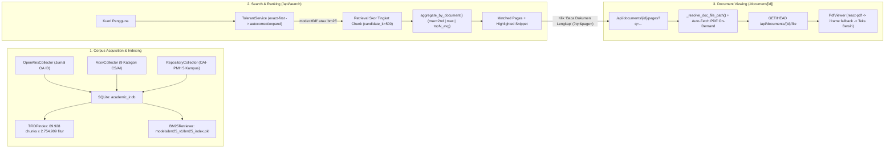

# Dokumentasi Update Retrieval & Akses Dokumen Penuh

> [!NOTE]
> Dokumen ini merangkum seluruh pembaruan pada subsistem **Document Retrieval, Corpus Harvesting, Indexing, Streaming Dokumen, dan Full-Page Reader** dalam sistem *Academic Information Retrieval (IR)* — mulai dari penambahan kolektor korpus baru, perluasan indeks **TF-IDF VSM** dan **Okapi BM25**, penyediaan endpoint streaming PDF *on-demand*, hingga perombakan antarmuka baca dokumen penuh berbasis `/document/[id]`.

---

## 1. Ringkasan Eksekutif Pembaruan

Untuk meningkatkan cakupan dokumen relevan (khususnya jurnal akademik berbahasa Indonesia, makalah ilmu komputer terkini, dan repositori skripsi/tesis) sekaligus menyelesaikan keterbatasan pembacaan dokumen di sisi antarmuka, pembaruan pada sisi retrieval mencakup 4 pilar utama:

1. **Ekspansi Kolektor & Pipeline Panen Korpus Terpadu**:
   - Kolektor baru **`OpenAlexCollector`** (`academic-ir/src/collectors/openalex.py`) untuk memanen jurnal *open-access* Indonesia beserta rekonstruksi abstrak dari *inverted index*.
   - Peningkatan **`ArxivCollector`** (`scripts/collect_arxiv.py`) dan **`RepositoryCollector`** (`src/collectors/repository.py`) untuk deduplikasi ketat, filter kualitas halaman/abstrak, serta cakupan multi-kategori/multi-kampus.
   - Skrip orkestrator **`harvest_training_corpus.py`** untuk memanen, memperbarui manifest, membangun ulang dataset latih, dan mengindeks ulang **TF-IDF VSM** serta **Okapi BM25** secara serentak.
2. **Pertumbuhan Indeks & Korpus Terverifikasi**:
   - Jumlah dokumen aktif meningkat menjadi **`1.960` dokumen** (`59.056` halaman fisik, `70.251` chunks pada SQLite), dengan **`69.928` chunk terindeks aktif** dan **`2.754.909` fitur kosakata (unigram + bigram)** pada indeks TF-IDF VSM (`+22.9%` chunks dan `+39.9%` vocab dibanding indeks sebelumnya).
3. **Retrieval Dual-Engine + Tolerant Layer + Delivery File PDF**:
   - Mesin retrieval tetap melayani dua model peringkat (`tfidf` dan `bm25`) dengan 3 strategi agregasi chunk-ke-dokumen (`max+2nd`, `max`, `topN_avg`) serta lapisan *Tolerant Retrieval* (`auto`, `always`, `off`).
   - Penambahan endpoint streaming berkas **`GET/HEAD /api/documents/{document_id}/file`** dengan mekanisme **auto-fetch & cache PDF on-demand** melalui `_resolve_doc_file_path()` serta pengayaan metadata `has_file` dan `file_url` pada `/api/documents/{id}` maupun `/api/documents/{id}/pages`.
4. **Full-Page Document Reader (`/document/[id]`) dengan `react-pdf`**:
   - Tombol **Baca Dokumen Lengkap** di kartu hasil pencarian (`result-card.tsx`) dan **Baca Dokumen** di landing carousel (`featured-carousel.tsx`) kini menavigasi ke halaman khusus `/document/[id]?q=...&page=...` yang menampilkan **PDF asli (Canvas `react-pdf`)**, **Native Browser PDF fallback (`<iframe>`)**, dan **Mode Teks Bersih** secara tersinkronisasi dengan `matched_pages`.

---

## 2. Arsitektur End-to-End Document Retrieval & Reader

---

## 3. Pembaruan Pipeline Panen Korpus (*Collectors & Scraping*)

### 3.1. Kolektor Baru: OpenAlex Indonesian Articles
File: `academic-ir/src/collectors/openalex.py`

- Memanen artikel jurnal nasional *open-access* berbahasa Indonesia melalui REST API resmi `https://api.openalex.org/works` lintas 4 bidang ilmu (`DEFAULT_OPENALEX_FILTERS`):
  - `fields/17` (*Computer Science*), `fields/22` (*Engineering*), `fields/14` (*Business / Management*), dan `fields/33` (*Social Sciences / Education*).
- Fungsi **`reconstruct_abstract()`**: menyusun kembali teks abstrak terurut dari format `abstract_inverted_index` milik OpenAlex serta membersihkan tag dan entitas HTML.
- Memilih URL PDF terbaik (`_extract_pdf_url()` dari `best_oa_location` atau daftar `locations`), lalu mengunduh dan mengekstrak PDF secara paralel memakai `ThreadPoolExecutor` dengan `requests.Session` terisolasi per thread (`_thread_local`).

### 3.2. Pembaruan Kolektor arXiv & Institutional Repository (OAI-PMH)
File: `academic-ir/scripts/collect_arxiv.py`, `academic-ir/src/collectors/repository.py`, `academic-ir/src/collectors/base.py`

| Komponen | Pembaruan Utama yang Diterapkan |
| :--- | :--- |
| **`ArxivCollector`** | - Migrasi endpoint ke `https://export.arxiv.org/api/query`. - Menolak entri tanpa abstrak memadai (`len(abstract) < 150`). - Deduplikasi terhadap `existing_keys` berbasis URL (`source_url`, `fulltext_url`) maupun normalisasi judul (`normalize_title_key()`). - Cakupan diperluas di skrip panen ke **9 kategori CS/AI**: `cs.IR`, `cs.CL`, `cs.LG`, `cs.AI`, `cs.DB`, `cs.SE`, `cs.CV`, `cs.NI`, `cs.CR`. |
| **`RepositoryCollector`** | - Mengonfigurasi 5 endpoint OAI-PMH kampus Indonesia (`DEFAULT_INDONESIAN_OAI_ENDPOINTS`: **Undip**, **UIN Malang**, **Unair**, **ITS**, **UIN Sunan Kalijaga**). - Seleksi URL fulltext cerdas via `_pick_best_pdf_url()` yang memprioritaskan berkas isi utama (`FULLTEXT_POS_HINTS`) di atas berkas sampul/daftar isi (`FRONTMATTER_NEG_HINTS`). - Penamaan file berbasis hash URL (`thesis_<md5>.pdf`), batas ukuran unduhan `20 MB`, deduplikasi `sha256` in-memory + DB dengan penghapusan file duplikat otomatis, serta filter kualitas minimum **`>= 3` halaman** dan **`>= 400` kata**. |
| **`harvest_training_corpus.py`** | - Menjalankan panen 3 fase secara berurutan (`--openalex-id`, `--arxiv`, `--thesis`, `--workers`), memperbarui `research.jsonl` (`+550` entri), `thesis.jsonl` (`+46` entri), dan `unified_manifest.csv` (`+596` entri), lalu otomatis memanggil `rebuild_search_indices()` untuk membangun ulang **TF-IDF** dan **Okapi BM25 (`k1=1.5, b=0.75`)**. |

---

## 4. Statistik Korpus & Pertumbuhan Indeks Aktual

Data berikut diverifikasi langsung dari `academic-ir/database/academic_ir.db`, `academic-ir/models/index_metadata.json`, dan direktori `academic-ir/models/`:

### 4.1. Perbandingan Pertumbuhan Indeks Pencarian (`index_metadata.json`)

| Metrik Indeks TF-IDF | Sebelum Pembaruan (`HEAD` Awal) | Setelah Ekspansi Korpus | Pertumbuhan |
| :--- | :---: | :---: | :---: |
| **`chunk_count`** | `56.881` | **`69.928`** | `+13.047` (`+22.9%`) |
| **`vocab_size`** (`ngram [1, 2]`) | `1.969.538` | **`2.754.909`** | `+785.371` (`+39.9%`) |
| **Bentuk Matriks** | `[56881, 1969538]` | **`[69928, 2754909]`** | — |

### 4.2. Ukuran Artefak Indeks di Disk (`academic-ir/models/`)
- `tfidf_matrix.npz`: **`94.92 MB`**
- `tfidf_vectorizer.pkl`: **`73.28 MB`**
- `chunk_ids.pkl`: **`1.27 MB`**
- `bm25_v1/bm25_index.pkl`: **`377.96 MB`**

### 4.3. Distribusi Korpus Terindeks di SQLite (`academic_ir.db`)

| Dimensi Statistik | Rincian Aktual |
| :--- | :--- |
| **Total Dokumen (`documents`)** | **`1.960` dokumen** (`1.960` memiliki `local_path`; **`885` memiliki abstrak**) |
| **Total Halaman & Chunks** | **`59.056` halaman fisik (`pages`)** dan **`70.251` baris `chunks`** mencakup seluruh `1.960` dokumen |
| **Berdasarkan Tipe Dokumen** | `MATERIAL`: **`1.074`** \| `RESEARCH`: **`719`** \| `THESIS`: **`167`** |
| **Berdasarkan Sumber** | `OCW_UI`: **`1.074`** \| `arXiv`: **`413`** \| `OpenAlex ID (Jurnal Nasional OA)`: **`300`** \| `Institutional Repository` *(Undip 109, UIN Malang 37, UIN Sunan Kalijaga 8, Unair 8, lainnya 5)*: **`167`** \| `CORE`: **`4`** \| `DOAJ`: **`2`** |
| **Berdasarkan Bahasa** | Indonesia (`id`): **`1.187`** \| Inggris (`en`): **`768`** \| Lainnya (`ar/ca/fr/sq`): **`5`** |

---

## 5. Pembaruan Lapisan Retrieval, Agregasi, & Streaming Dokumen

### 5.1. Orkestrasi Pencarian (`GET /api/search` & `GET /api/tolerant/suggest`)
File: `academic-ir/app/api.py`, `academic-ir/src/retrieval/aggregation.py`

- **Dual Retrieval Engine**: parameter `retrieval_mode` memilih antara `tfidf` (default `TFIDFIndex` + `SearchEngine`) dan `bm25` (`BM25Retriever` di `models/bm25_v1`, dengan fallback otomatis ke TF-IDF jika model BM25 tidak tersedia).
- **Tolerant Retrieval**: `TolerantService` menjalankan strategi **exact-first**, dan hanya memicu koreksi ejaan/ekspansi kueri (`did_you_mean`, `corrections`, `expanded_terms`) ketika hasil eksak kosong atau ketika `tolerant_mode="always"`. Autocomplete/saran kueri disajikan oleh `/api/tolerant/suggest`.
- **Agregasi Chunk-ke-Dokumen (`aggregate_by_document`)**:
  - Mendukung 3 strategi pada `candidate_k` (default `500`): `max`, `max+2nd` *(default, bobot `SECOND_BEST_LAMBDA = 0.3` untuk chunk terbaik kedua)*, dan `topN_avg` *(rata-rata berbobot 3 chunk teratas)*.
  - Setiap hasil membawa `best_page_start`, `best_page_end`, `matched_pages`, `chunk_count`, dan `snippet` dari chunk dengan skor tertinggi.

### 5.2. Endpoint Akses Berkas PDF & Resolusi On-Demand (`_resolve_doc_file_path`)
File: `academic-ir/app/api.py`

- **`GET/HEAD /api/documents/{document_id}/file` (Baru)**:
  - Menggunakan `_resolve_doc_file_path(local_path, [fulltext_url, source_url])` untuk mencari berkas PDF lokal pada `PROJECT_ROOT / local_path`.
  - **Auto-Fetch & Cache On-Demand**: apabila berkas fisik belum ada di disk namun `fulltext_url` atau `source_url` merupakan tautan PDF valid (`.pdf`, `arxiv.org/pdf`, `pluginfile.php`), server mengunduhnya otomatis (`timeout=8s`), memvalidasi magic bytes `%PDF`, menyimpan ke jalur cache lokal, lalu mengalirkannya langsung ke browser dengan header:
    - `Content-Disposition: inline; filename="..."`
    - `Accept-Ranges: bytes` (mendukung seek/paging PDF)
    - `Cache-Control: public, max-age=3600`
- **Pengayaan `/api/documents/{document_id}` & `/api/documents/{document_id}/pages`**:
  - Kedua endpoint kini menyertakan field **`has_file`**, **`file_url`**, dan **`file_type`** agar frontend dapat menentukan apakah dokumen bisa langsung dirender dalam mode PDF asli atau menggunakan transkrip teks lengkap per halaman (`pages` + `matched_pages`).

---

## 6. Pembaruan Antarmuka Pembaca Dokumen Penuh (*Full-Page Reader*)

File terkait:
- `academic-ir/academic-ir-frontend/src/app/document/[id]/page.tsx`
- `academic-ir/academic-ir-frontend/src/components/pdf-viewer.tsx`
- `academic-ir/academic-ir-frontend/src/components/result-card.tsx`
- `academic-ir/academic-ir-frontend/src/components/landing/featured-carousel.tsx`
- `academic-ir/academic-ir-frontend/src/lib/api.ts`

Pembaruan utama pada sisi UI pembaca dokumen:
1. **Navigasi Route Dedikatif `/document/[id]`**:
   - Menggantikan modal sempit dengan halaman layar penuh melalui tautan **Baca Dokumen Lengkap** di `result-card.tsx` (`/document/<id>?q=<query>&page=<page>`) dan **Baca Dokumen** di `featured-carousel.tsx`.
2. **Penampil PDF Multi-Fallback (`PdfViewer` dengan `react-pdf`)**:
   - Menggunakan `react-pdf` + `pdfjs-dist` (`AnnotationLayer` dan `TextLayer`) lengkap dengan kontrol zoom (`75%–200%`), navigasi halaman (`activePage / totalPages`), dan tombol unduh PDF.
   - Bila rendering canvas gagal, UI menyediakan pemulihan 1 klik menuju **Native Browser PDF Viewer (`<iframe>` ke `#page=...`)** maupun peralihan ke **Mode Teks Bersih** (`A-` / `A` / `A+` + salin teks per halaman).
3. **Pelacakan Halaman Cocok Kueri (*Query-Matched Pages*)**:
   - Jika dibuka dari hasil pencarian (`?q=...`), pita **Halaman Cocok Kueri** (`data.matched_pages`) menampilkan tombol lompat langsung `Hal. X` di atas reader, sementara mode Teks Bersih menyoroti token kueri (`highlightTokens`) dan sidebar kanan terhubung ke `activePage` melalui `onJumpToPage`.

---

## 7. Ringkasan Verifikasi Sistem

- **Startup FastAPI (`uvicorn app.api:app` di `127.0.0.1:8000`)**: memuat **`69.928` chunks** dengan **`2.754.909` fitur TF-IDF** tanpa galat.
- **TypeScript Frontend (`tsc --noEmit`)**: **exit 0** (termasuk route `/document/[id]`, `PdfViewer`, `result-card.tsx`, dan `featured-carousel.tsx`).
- **Endpoint Pengambilan Dokumen & Ringkasan**: terverifikasi mengembalikan `200 OK` untuk metadata dokumen, halaman, dan ringkasan dual-mode pada korpus yang baru dipanen (contoh `RES-000317` dari hasil *scraping* OpenAlex ID dan `RES-000006` dari arXiv).
