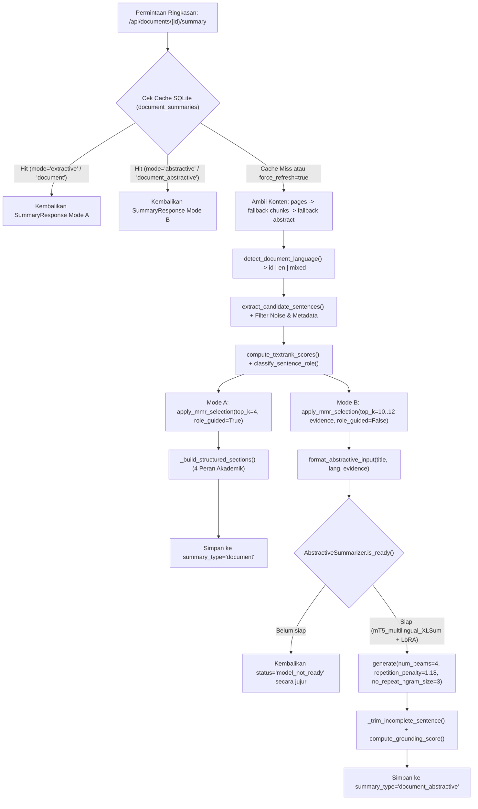

# Dokumentasi Update Pipeline Text Summarization (Dual-Mode Non-Destruktif)

> [!NOTE]
> Dokumen ini merangkum seluruh pembaruan modul **Text Summarization** pada sistem *Academic Information Retrieval (IR)* — mencakup peningkatan **Mode A (Extractive v2 Role-Guided)**, pembangunan **Mode B (Fine-Tuned Abstractive mT5 + LoRA via Extract-then-Abstract / Jalur A)**, mekanisme anti-leakage & decoding guardrails, isolasi cache SQLite, serta pembaruan antarmuka pengguna bertumpuk (*stacked dual-mode GUI*).

---

## 1. Ringkasan Eksekutif Pembaruan

Sebelum pembaruan ini, sistem hanya menyediakan ringkasan ekstraktif datar (`textrank_mmr`) yang langsung menggabungkan kalimat-kalimat terpilih tanpa klasifikasi peran akademik maupun opsi penyusunan kalimat berbahasa alami. Pembaruan ini menghadirkan arsitektur **Dual-Mode Non-Destruktif**:

1. **Mode A — Extractive v2 Role-Guided (`textrank_mmr_v2`)** *(Default, tetap dipertahankan utuh)*:
   - Pembersihan noise akademik tingkat lanjut (header/footer berulang, dot-leader daftar isi, entri bibliografi, metadata sampul/RPS, baris jadwal, serta pelindung singkatan EN/ID).
   - Klasifikasi **4 Peran Struktural Akademik** (`topik_utama`, `konsep_penting`, `pembahasan`, `informasi_pendukung`) pada `textrank.py` dan seleksi **Role-Guided MMR** pada `mmr.py`.
2. **Mode B — AI Abstractive Fine-Tuned (`mt5_lora_abstractive`)** *(Section Bawah / Pendamping)*:
   - Pendekatan **Extract-then-Abstract (Jalur A)**: menyaring `top_k` kalimat bukti terbaik via TextRank + MMR, lalu mensintesis paragraf ringkasan yang mengalir menggunakan model **PEFT LoRA (`csebuetnlp/mT5_multilingual_XLSum`)** yang dilatih pada dataset anti-leakage dari korpus lokal.
   - Dilengkapi pengukuran keterikatan leksikal (*grounding score*), thread-safe model loading (`threading.Lock`), dan *decoding guardrails* (`repetition_penalty=1.18`, `max_length=None`, pemangkasan kalimat terpotong).
3. **Query-Focused Cross-Lingual Summarization (`multilingual_embedding_mmr`)**:
   - Tetap beroperasi pada tab **Kueri** dengan penyaringan kalimat substantif yang lebih bersih melalui `extract_candidate_sentences()`.
4. **Antarmuka Bertumpuk (*Stacked Dual-Mode UI*)**:
   - Fitur ekstraktif lama tidak dihapus dan tidak disembunyikan di balik toggle eksklusif: **Section 1 (Atas)** menampilkan ringkasan ekstraktif beserta poin terstruktur & sitasi halaman; **Section 2 (Bawah)** menampilkan paragraf hasil model AI *fine-tuned*.

---

## 2. Arsitektur End-to-End Dual-Mode Summarization

---

## 3. Pembaruan Mode A — Extractive Summarization v2 (`textrank_mmr_v2`)

### 3.1. Preprocessing & Filter Kebisingan Akademik
File: `academic-ir/src/summarization/preprocessing.py`

Pipeline preprocessing diperketat agar kalimat yang masuk ke graf TextRank maupun ke bukti Mode B bebas dari fragmen administratif dan artefak ekstraksi PDF:

- **Pelindung Singkatan Akademik (`ABBREV_PATTERN`)**: Mencegah pemecahan kalimat palsu pada singkatan Inggris (`et al.`, `e.g.`, `i.e.`, `fig.`, `eq.`, `vol.`, `ph.d.`) dan Indonesia (`dkk.`, `hlm.`, `hal.`, `s.kom.`, `m.kom.`, `gb.`, `bab.`), serta angka desimal.
- **Filter Pola Struktural & Artefak Dokumen**:
  - `BULLET_LINE_RE`: membersihkan penanda bullet Unicode dan nomor urut daftar.
  - `PAGE_NUMBER_LINE_RE`: menyaring baris nomor halaman mandiri (mis. `Halaman 3 / 12`, `Page 4`).
  - `SECTION_HEADING_LINE_RE`: membuang judul bab berdiri sendiri (`BAB II TINJAUAN PUSTAKA`, `2.1 Related Work`).
  - `TOC_DOT_LEADER_RE`: membuang baris daftar isi dengan titik berulang (`...... 14`).
  - `BIBLIO_ENTRY_RE`: menyaring entri daftar pustaka bergaya APA/IEEE/URL/ISBN/DOI/ISSN.
  - `COVER_METADATA_RE`: membuang metadata sampul skripsi, NIM/NPM/NIDN/NIP, RPS/BRP, dosen pengampu, dan hak cipta.
  - `SCHEDULE_TABLE_RE`: menyaring baris tabel jadwal kuliah atau penanda `Sub-CMPK`.
- **Deteksi Bahasa dengan Dukungan Code-Switching**: `academic-ir/src/summarization/lang_detect.py` (`detect_document_language`) mengklasifikasikan dokumen menjadi `id`, `en`, atau `mixed` (apabila probabilitas `id` dan `en` sama-sama `>= 0.25` atau keduanya berada pada rentang `0.20..0.80`) guna memilih daftar stopwords Sastrawi + NLTK yang tepat melalui `get_language_stopwords()`.

### 3.2. TextRank + Klasifikasi 4 Peran Akademik
File: `academic-ir/src/summarization/textrank.py`

Fungsi `compute_textrank_scores()` memadukan representasi TF-IDF `(1, 2)`-gram bersublinear TF, matriks kemiripan kosinus (dengan `damping = 0.85`, `max_iter = 100`, `tol = 1e-5`, `sim_threshold = 0.05`), serta `classify_sentence_role()` berbasis pencocokan pola bilingual `ROLE_CUES` dan prior posisi halaman:

| Kunci Peran (`role`) | Label UI (`role_label`) | Fokus Pola Kata Kunci (`ROLE_CUES`) & Prior Posisi |
| :--- | :--- | :--- |
| `topik_utama` | **Topik Utama** | *membahas, tujuan, mengusulkan, penelitian ini, in this paper, proposes* + boost di `20%` awal halaman atau 5 kalimat pertama (`+1.0`). |
| `konsep_penting` | **Konsep Penting** | *adalah, merupakan, didefinisikan sebagai, teori, arsitektur, is defined as, refers to* + boost di paruh awal dokumen (`<= 50%`, `+0.5`). |
| `pembahasan` | **Pembahasan** | *karena, proses, tahapan, metode, cara kerja, analisis, mechanism, approach* + boost di rentang `25%–85%` halaman (`+0.8`). |
| `informasi_pendukung` | **Informasi Pendukung** | *contoh, implementasi, hasil, pengujian, eksperimen, dataset, evaluation, benchmark* + boost di `40%` akhir halaman (`>= 60%`, `+0.8`). |

### 3.3. Seleksi Role-Guided MMR
File: `academic-ir/src/summarization/mmr.py`

`apply_mmr_selection()` menerima parameter `role_guided: bool = True` dan `lambda_param: float = 0.70`:
- Ketika `role_guided=True` dan `top_k >= 3`, seleksi terlebih dahulu mengambil representasi terbaik dari tiap `TARGET_ROLES` sambil tetap menerapkan penalti redundansi MMR terhadap kalimat yang sudah terpilih (tanpa memaksakan jika peran tertentu tidak muncul di dokumen).
- Sisa kuota `k` diisi dengan kriteria MMR standar, lalu seluruh kalimat terpilih diurutkan kembali secara kronologis berdasarkan `(page, order_idx)`.
- Hasil kemudian dikemas oleh `_build_structured_sections()` di `academic-ir/src/summarization/service.py` menjadi `structured_sections` sekaligus narasi `grounded_summary_text` dengan kutipan halaman `(Hal. X)`.

### 3.4. Pembaruan Skema & Isolasi Cache SQLite
File: `academic-ir/src/summarization/schemas.py` & `academic-ir/src/summarization/storage.py`

- `SentenceItem` menambahkan kolom `role` dan `role_label`; model baru `SummarySection` mendeskripsikan blok peran terstruktur.
- `SummaryResponse` kini memuat `mode` (`"extractive"` / `"abstractive"`), `model_name`, `grounding_score`, `grounded_summary_text`, `evidence_sentences`, `structured_sections`, serta status `"model_not_ready"`.
- `SummaryStorage` menggunakan `_resolve_db_summary_type()` untuk memisahkan slot cache di tabel `document_summaries` tanpa mengubah skema SQLite:
  - Mode A disimpan pada `summary_type = 'document'` (dan dilayani kembali hanya bila `algorithm == 'textrank_mmr_v2'`).
  - Mode B disimpan pada `summary_type = 'document_abstractive'`.
  - Baris lama dengan `query_text IS NULL` dibersihkan sebelum `INSERT OR REPLACE` agar tidak menumpuk duplikat.

---

## 4. Pembaruan Mode B — Fine-Tuned Abstractive Summarization (Jalur A)

### 4.1. Pembentukan Dataset Latih Anti-Leakage
Skrip: `academic-ir/scripts/prepare_summarization_dataset.py`  
Output stats: `academic-ir/data/summarization_dataset/dataset_stats.json`

Untuk melatih model Seq2Seq tanpa kebocoran data (*data leakage*), pasangan `(input_text, target_summary)` dibangun menggunakan pipeline **Extract-then-Abstract**:

1. **Pembersihan Abstrak Target (`clean_target_abstract`)**: menghapus tag HTML/entity, awalan `"Abstract:"` / `"Abstrak:"`, memisahkan abstrak dwibahasa panjang (> 1.200 karakter) agar selaras dengan bahasa utama dokumen, dan memotong rapi di batas kalimat hingga `220` kata.
2. **Penghapusan Kebocoran Sebelum TextRank**: banyak dokumen PDF mencantumkan abstrak yang sama di halaman 1–2. Kalimat kandidat yang tumpang tindih dengan abstrak target dihapus **sebelum** penskoran TextRank-12 — tercatat **`17.048` kalimat bocor berhasil disaring**.
3. **Filtering Kelayakan**: dokumen dengan abstrak terlalu pendek setelah pembersihan, atau dokumen *abstract-only* (< 6 kalimat non-bocor / < 120 kata), dikeluarkan dari dataset.
4. **Statistik Dataset Aktual**:
   - Total dokumen berabstrak dievaluasi: **`883`**
   - Dokumen layak pakai (*usable*): **`826`** (`57` dilewati: `49` `abstract_only_or_insufficient`, `7` `short_abstract_after_clean`, `1` `no_candidates`)
   - Pembagian *stratified split* 80/10/10 (`seed = 42`, `top_k_evidence = 12`):
     - **`train`: `658`** (`RESEARCH:en` 332, `RESEARCH:id` 238, `THESIS:id` 68, `THESIS:en` 18, `THESIS:mixed` 2)
     - **`val`: `84`** (`RESEARCH:en` 42, `RESEARCH:id` 30, `THESIS:id` 9, `THESIS:en` 2, `THESIS:mixed` 1)
     - **`test`: `84`** (`RESEARCH:en` 42, `RESEARCH:id` 30, `THESIS:id` 9, `THESIS:en` 2, `THESIS:mixed` 1)
   - Panjang rata-rata input: **`313.2` kata**; panjang rata-rata target: **`176.7` kata**.
   - Disiapkan pula **`130`** kandidat dokumen `MATERIAL` pada `academic-ir/data/summarization_dataset/materials_for_distillation.jsonl` (belum terisi target ringkasan / masih menunggu distilasi).

Format prompt standar disatukan oleh `format_abstractive_input()` di `academic-ir/src/summarization/abstractive.py`:
- Bahasa Indonesia / Campuran: `ringkas dokumen akademik [id]: <judul>. <evidence_sentences>`
- Bahasa Inggris: `summarize academic document [en]: <title>. <evidence_sentences>`

### 4.2. Pelatihan Model LoRA & Artefak Bobot Lokal
Skrip & Notebook: `academic-ir/notebooks/train_abstractive_summarizer_colab.ipynb`, `academic-ir/scripts/train_abstractive_summarizer.py`, `academic-ir/requirements-training.txt`  
Direktori model aktif: `academic-ir/models/abstractive_summarizer/` (salinan arsip juga tersimpan di `academic-ir/abstractive_summarizer/`)

| Parameter Konfigurasi | Nilai Terpasang (`adapter_config.json` & `training_metadata.json`) |
| :--- | :--- |
| **Base Model** | `csebuetnlp/mT5_multilingual_XLSum` (`585.940.224` parameter total) |
| **Metode Adaptasi** | PEFT LoRA (`SEQ_2_SEQ_LM`), `merged_lora = false` |
| **Parameter LoRA** | `r = 16`, `lora_alpha = 32`, `lora_dropout = 0.05`, `target_modules = ["k", "q", "o", "v"]` |
| **Parameter Terlatih** | `3.538.944` parameter (`0.6040%` dari total model) |
| **Epoch & Data Tambahan** | `5` epoch; `658` sampel korpus lokal (`xlsum_id_samples_added = 0`) |
| **Artefak Adapter** | `adapter_model.safetensors` (`13.54 MB`), `tokenizer.json` (`15.57 MB`), `adapter_config.json`, `tokenizer_config.json`, `training_metadata.json` |
| **Waktu Pelatihan (UTC)** | `2026-11-19T16:56:37.546001+00:00` |

### 4.3. Loader Inferensi, Thread-Safety, & Guardrails Decoding
File: `academic-ir/src/summarization/abstractive.py`

Agar model fine-tuned dapat berjalan stabil pada backend FastAPI (CPU lokal maupun GPU opsional) tanpa merusak lingkungan ringan:
- **Lazy Import**: `torch`, `transformers`, `peft`, dan `sentencepiece` hanya dimuat ketika inferensi Mode B dipanggil (`is_ready()`), sedangkan status ketersediaan dicek non-blocking oleh `get_model_status()`.
- **Kompatibilitas Fast Tokenizer Transformers v5**: `tokenizer.json` hasil penyimpanan Colab dimuat langsung melalui `AutoTokenizer.from_pretrained(tok_src)` dengan fallback otomatis ke `use_fast=False`; `sentencepiece` dibuat opsional apabila `tokenizer.json` sudah tersedia.
- **Keamanan Konkurensi (`threading.Lock`)**: `is_ready()` memakai *double-checked locking* menggunakan `self._lock` sehingga permintaan paralel (seperti *React StrictMode* pada `next dev`) tidak mengalami *race condition* dan keliru melaporkan `model_not_ready` saat pemuatan pertama kali.
- **Guardrail Generasi & Pasca-Proses**:
  - Parameter decoding: `num_beams=4`, `no_repeat_ngram_size=3`, `repetition_penalty=1.18`, `length_penalty=1.2`, `min_length=45`, `max_length=None`, `max_new_tokens=200`, `early_stopping=True`.
  - `_trim_incomplete_sentence()`: memangkas klausa menggantung jika beam decoding berhenti sebelum tanda baca akhir kalimat (mempertahankan minimal 60 karakter hingga terminator `[.!?]` terakhir).
  - `compute_grounding_score()`: menghitung proporsi kata konten non-stopword pada teks hasil generasi yang benar-benar berakar di kalimat bukti sumber (`[0.0, 1.0]`).

---

## 5. Pembaruan Endpoint API & Antarmuka Pengguna (Stacked GUI)

### 5.1. Endpoint Backend (`academic-ir/app/api.py`)
| Endpoint | Method | Fungsi Utama |
| :--- | :---: | :--- |
| `/api/summarization/model-status` | `GET` | Inspeksi kesiapan bobot LoRA, paket Python terpasang (`torch`, `transformers`, `peft`, `sentencepiece`), `device`, `training_metadata`, dan `dataset_stats` tanpa memblokir. |
| `/api/documents/{document_id}/summary` | `GET` | Mendukung parameter `mode=extractive` *(default)* atau `mode=abstractive`, `max_sentences`, `lambda_param`, dan `force_refresh`. |
| `/api/documents/{document_id}/query-summary` | `POST` | Ringkasan terfokus kueri lintas bahasa (`multilingual_embedding_mmr`) dengan `query`, `max_sentences`, `lambda_param`, dan `force_refresh`. |

### 5.2. Tampilan Bertumpuk di Frontend
File:
- `academic-ir/academic-ir-frontend/src/lib/api.ts` (penambahan tipe `SummarySection`, field Mode B pada `SummaryResponse`, serta parameter `mode` pada `fetchDocumentSummary`)
- `academic-ir/academic-ir-frontend/src/components/reader/document-summary-sidebar.tsx`
- `academic-ir/academic-ir-frontend/src/components/summary-dialog.tsx`

Baik sidebar **Intisari** di halaman pembuka dokumen (`/document/[id]`) maupun modal **Ringkasan** pada kartu hasil pencarian tidak lagi menggunakan toggle eksklusif yang menyembunyikan hasil ekstraktif. Keduanya otomatis memuat kedua mode secara paralel dan menampilkannya bertumpuk vertikal:
1. **Section Atas — `1. Ringkasan Ekstraktif (TextRank + MMR)`**: tetap menampilkan mode *Intisari Terstruktur (4 Poin)* ber-badge peran, *Urutan Kronologis*, *Alur Narasi Utuh*, tombol salin, serta tombol lompat `Hal. X`.
2. **Pemisah (`<Separator />`)**
3. **Section Bawah — `2. AI Abstraktif (Model Fine-Tuned)`**: menampilkan badge model (`csebuetnlp/mT5_multilingual_XLSum + LoRA`), badge **`Grounding: XX%`**, latensi / indikator `Cache`, tombol *Perbarui* & *Salin* independen, kartu prosa ringkasan bahasa alami, serta tombol referensi `Hal. X`. Jika bobot belum tersedia, UI menampilkan panduan jelas (`model_not_ready`).

---

## 6. Evaluasi Model, Hasil Uji Nyata, & Saran Pengembangan v2

### 6.1. Evaluasi Kuantitatif (Test Set `N = 84`, `training_metadata.json` & `evaluate_abstractive_vs_extractive.py`)

| Metrik Evaluasi | Mode A — Extractive (`textrank_mmr_v2`) | Mode B — Fine-Tuned mT5 + LoRA (Test `N=84`) | Mode B (Val `N=84`) | Selisih Test (Mode B vs Mode A) |
| :--- | :---: | :---: | :---: | :---: |
| **ROUGE-1** | `0.2389` | **`0.2442`** | `0.2548` | `+0.0053` |
| **ROUGE-2** | `0.0453` | **`0.0571`** | `0.0581` | `+0.0118` |
| **ROUGE-L** | `0.1253` | **`0.1388`** | `0.1456` | `+0.0135` |
| **Loss** | `—` | `3.5444` | `3.6603` | `—` |
| **Grounding Baseline** | `1.0000` (verbatim) | Dinamis per dokumen (`0.60–0.96`) | `—` | Ekstrak fakta murni vs sintesis |

> [!IMPORTANT]
> Secara kuantitatif, model LoRA v1 **sudah melampaui baseline ekstraktif pada seluruh metrik ROUGE**. Namun `eval_loss` sebesar `3.6603` dan ukuran data latih (`658` dokumen) menunjukkan model masih berada pada tahap **prototipe awal (v1)** yang ideal dijalankan berdampingan dengan Mode Ekstraktif.

### 6.2. Evaluasi Kualitatif Aktual pada 3 Sampel Korpus (CPU Inference)

1. **`RES-000317` (Paper Indonesia — Hasil Terbaik)**
   - **Perbandingan**: Mode Ekstraktif mencampur fragmen Inggris–Indonesia dari awal kalimat yang terputus (*"In designing the infrastructure... Oleh karena itu..."*), sedangkan Mode Abstraktif menghasilkan paragraf padu berbahasa Indonesia dengan **`grounding_score: 0.9565` (96%)** dalam `13.297 ms` (saat pemuatan pertama di API; ~`7.4 detik` saat model hangat di memori dan instan ketika tersimpan di cache SQLite).
   - **Keluaran**: *"Sebuah sistem aplikasi Antrian Cucian Mobil Berbasis Website menggunakan Konsep Customer Relationship Management (CRM) dan Penerapan UML. Aplikasi ini digunakan untuk merancang sebuah sistem penjadwalan antrian cuci mobil dengan menggunakan konsep CRM dan penerapan Unified Modeling Language (UML)."*
2. **`MAT-000722` (Slide Kuliah / `MATERIAL` — Catatan Bias Domain)**
   - Lebih terbaca dibanding potongan poin slide (`grounding_score: 0.7241`), tetapi memunculkan kalimat template *"Dalam penelitian ini..."* padahal dokumen berupa materi slide, serta mencampur judul file mentah dengan singkatan (*"Internet File (ISP)"*). Ini terjadi karena 100% data latih berasal dari `RESEARCH` + `THESIS` (`0` sampel distilasi `MATERIAL`).
3. **`RES-000006` (Paper Inggris — *Sentence-BERT* — Dampak Guardrail Decoding)**
   - Sebelum guardrail (`abstractive.py` awal), teks mengalami pengulangan frasa dan berhenti di tengah kalimat (*"...gives a best results on the"*, `grounding_score: 0.5682`).
   - Setelah penambahan `repetition_penalty=1.18`, `max_length=None`, dan `_trim_incomplete_sentence()`, ringkasan berakhir utuh pada titik kalimat (*"...We investigated a range of different types of Sentence Embeddings."*) dengan `grounding_score` naik menjadi **`0.6047`** (`19.152 ms` CPU). Masih terlihat distorsi minor istilah teknis (*"nfL6"*, *"three batchs"*) akibat jumlah data Inggris yang terbatas.

### 6.3. Status Verifikasi Terkini
- **Unit Test (`academic-ir/tests/test_dual_mode_summarization.py`)**: **5/5 lulus** (`0.763s`).
- **TypeScript (`tsc --noEmit`)**: **exit 0** (0 error).
- **Endpoint FastAPI Langsung (`127.0.0.1:8000`)**: `GET /api/summarization/model-status` (`ready: true`, `model_type: "lora"`), `RES-000317` (`mode=extractive` & `mode=abstractive` -> `200 OK`), `RES-000006` (`mode=abstractive` -> `200 OK`).

### 6.4. Rekomendasi Peningkatan Model (Versi v2)
1. **Isi Data Distilasi Slide (`MATERIAL`)**: lengkapi `materials_for_distillation.jsonl` (130 kandidat tersedia) agar model mengenali struktur diktat/slide kuliah tanpa mengasumsikan semua dokumen adalah *"penelitian"*.
2. **Tambah Korpus Abstrak Indonesia Berkualitas (Parquet)**: muat dataset ringkasan publik berbasis Parquet (pengganti skrip `xlsum.py` lama) untuk menekan `eval_loss` di bawah `2.5` dan menstabilkan tata bahasa Indonesia maupun istilah teknis Inggris.
3. **Eksperimen Backbone / Hyperparameter Tambahan**: uji penambahan epoch (dengan *early stopping*) atau bandingkan adapter pada backbone khusus Bahasa Indonesia/multilingual yang lebih terkalibrasi.
