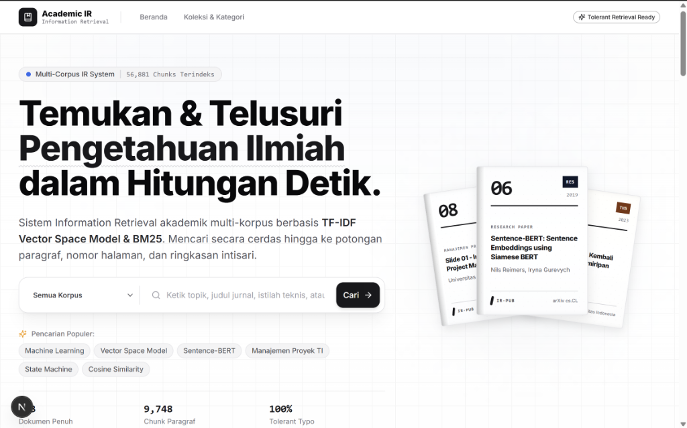
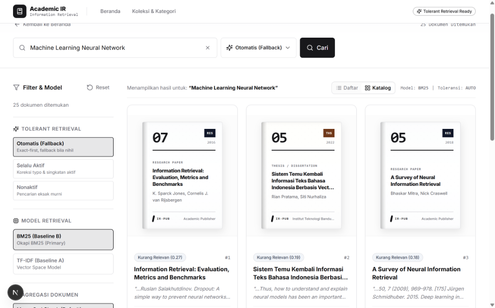

# Academic IR — Unified Multi-Corpus Academic Search Engine

> **Sistem Temu Kembali Informasi Dokumen Akademik Lintas Disiplin Ilmu Berbasis Machine Learning**  
> Mengimplementasikan pendekatan **Dual-Baseline: TF-IDF Vector Space Model (VSM)** dan **Okapi BM25** dengan **Document-Level Aggregation** (`max`, `max+2nd`, `topN_avg`) serta integrasi antarmuka modern **Next.js 15 (React 19)** dan backend berkecepatan tinggi **FastAPI**.

---

## 🖼️ Tampilan Antarmuka Sistem (Modern Editorial Web Interface)

Sistem Information Retrieval ini dilengkapi antarmuka web modern bergaya editorial monokromatik dengan cover dokumen prosedural minimalis Swiss:

### 1. Halaman Awal & Hero Showcase (Landing Page)
Menghadirkan pencarian multi-korpus terpadu, pemilih korpus, tag kueri populer, dan display 3D perspektif cover dokumen akademik.



### 2. Tampilan Katalog Hasil Pencarian (Grid Catalog & Swiss Cover)
Menampilkan potongan dokumen relevan dalam format katalog buku/jurnal ber-cover minimalis yang memuat nomor indeks numerik, penanda korpus, judul, dan institusi.



---

## 📌 Ringkasan Sistem (*Executive Summary*)

**Academic IR** dirancang untuk menyelesaikan masalah *information silo* dan *fragment redundancy* pada repositori akademik. Sistem ini menyatukan pencarian terhadap tiga pilar dokumen ilmiah:
1. **Bahan Kuliah (*Course Materials / OpenCourseWare*)**: Slide, silabus, dan Buku Rancangan Pengajaran (BRP) dari 14 fakultas OCW UI.
2. **Artikel Jurnal Ilmiah (*Research Papers*)**: Publikasi ilmiah mutakhir dari arXiv dan Directory of Open Access Journals (DOAJ).
3. **Karya Ilmiah Mahasiswa (*Theses / Dissertations*)**: Skripsi dan tugas akhir komputasi & sistem informasi.

### Karakteristik Korpus & Indeks Terkini
- **Total Dokumen:** 1.364 dokumen akademik.
- **Total Chunks Terindeks:** 57.202 potongan teks granular (jendela geser 200–400 kata, *overlap* 50 kata).
- **Ruang Kosakata (*Vocabulary Space*):** 1.969.538 term (kombinasi unigram dan bigram).
- **Dual Retrieval Engine:**
  - **Baseline A:** TF-IDF (Sublinear TF, Smooth IDF) + Cosine Similarity.
  - **Baseline B:** Okapi BM25 ($k_1=1.5, b=0.75$) dengan *inverted index* in-memory.
- **Document-Level Aggregation:** Mencegah satu skripsi tebal memonopoli hasil pencarian dengan mengagregasi skor potongan ke tingkat dokumen utuh via strategi `max+2nd` ($\lambda=0.3$).
- **Provenance Transparency:** Mendokumentasikan status akses korpus publik sebagai *benchmark proxy* melalui endpoint `/api/provenance`.

---

## 📊 Hasil Evaluasi & Benchmark Ilmiah

Berdasarkan pengujian otomatis pada **33 kueri akademik terstruktur** (mencakup 6 taksonomi kueri IREval) dengan **942 penilaian relevansi bergradasi (*qrels*)**:

| Metrik Evaluasi | Baseline A: TF-IDF (VSM) | Baseline B: BM25 Okapi | Selisih ($\Delta$) | Peningkatan Relatif |
| :--- | :---: | :---: | :---: | :---: |
| **Mean Average Precision (MAP)** | **0.0832** | **0.1235** | **+0.0403** | **+48.4%** |
| **Mean Reciprocal Rank (MRR)** | **0.3990** | **0.4270** | **+0.0280** | **+7.0%** |
| **Precision@5 (P@5)** | **0.2667** | **0.2848** | **+0.0181** | **+6.8%** |
| **Precision@10 (P@10)** | **0.2182** | **0.2364** | **+0.0182** | **+8.3%** |
| **Recall@10 (R@10)** | **0.1186** | **0.1506** | **+0.0320** | **+27.0%** |
| **NDCG@10** | **0.2490** | **0.2992** | **+0.0502** | **+20.2%** |

### Benchmark Latensi Operasional (pada 56.881 chunks)
- **BM25 Okapi:** **P50 = 85,95 ms** | **P95 = 104,89 ms** (hampir 10x lebih cepat daripada TF-IDF VSM: P50 = 766,92 ms).
- Memenuhi target Service Level Agreement sistem ($\le 250$ ms) dengan margin yang aman.

---

## 🏗️ Arsitektur Perangkat Lunak

```text
[ Pengguna / Browser ]
         │
         │ HTTP / JSON (Port 3000)
         ▼
[ Presentation Tier: Next.js 15 + Tailwind CSS + shadcn/ui ]
  - Search Bar dengan Debounce & Sanitasi Event
  - Filter Sidebar: Model Switcher (TF-IDF vs BM25) & Agregasi (max, max+2nd, topN_avg)
  - Result Cards: Label Kualitatif (Sangat Relevan/Relevan), Bukti Halaman, & Provenance
         │
         │ REST API (Port 8000)
         ▼
[ Application Tier: FastAPI Backend Server ]
  - /api/search      : Parameter retrieval_mode, aggregation_strategy, candidate_k
  - /api/provenance  : Metadata legalitas & sumber korpus
  - /api/health      : Health check status indeks
  - /api/stats       : Statistik agregat korpus
         │
         ├── Preprocessing Pipeline (Case folding, Stopwords Tala/NLTK, Stemming Sastrawi/Snowball)
         ├── Candidate Pool Selection (candidate_k = 500)
         ├── Document-Level Aggregation (src/retrieval/aggregation.py)
         │
         ▼
[ Persistence & Model Tier ]
  ├── SQLite Database (academic_ir.db) -> Metadata Dokumen, Halaman & Chunks
  ├── TF-IDF Vector Space Index        -> tfidf_vectorizer.pkl & tfidf_matrix.npz
  └── BM25 Okapi Index                 -> bm25_v1/bm25_index.pkl
```

---

## 🚀 Panduan Menjalankan Sistem (*Setup & Running Guide*)

Bagian ini menyediakan panduan langkah demi langkah agar siapa pun yang melakukan `git clone` terhadap repositori ini dapat langsung menyiapkan lingkungan dan menjalankan sistem secara lancar.

---

### 1. Prasyarat Lingkungan (*Prerequisites*)

Pastikan perangkat Anda telah terpasang:
- **Git** (`git --version`)
- **Python 3.10+** (`python --version`)
- **Node.js 18+ atau 20+ LTS** (`node --version`) dan **npm** (`npm --version`)

---

### 2. Clone Repositori

```bash
git clone https://github.com/pramacoder/TemuKembaliInformasi.git
cd TemuKembaliInformasi
```

---

### ⚡ Quick Start: Menjalankan Sistem (2 Terminal)

Sistem menggunakan arsitektur terpisah antara backend FastAPI dan frontend Next.js. Jalankan keduanya pada dua terminal terpisah:

#### 🖥️ Terminal 1 — Backend REST API (FastAPI)

1. Masuk ke direktori backend:
   ```bash
   cd academic-ir
   ```

2. Buat dan aktifkan *Python Virtual Environment*:
   ```powershell
   # Di Windows (PowerShell):
   python -m venv venv
   .\venv\Scripts\activate

   # Di Windows (Command Prompt / CMD):
   python -m venv venv
   venv\Scripts\activate.bat

   # Di macOS / Linux:
   python3 -m venv venv
   source venv/bin/activate
   ```

3. Install seluruh dependensi backend:
   ```bash
   pip install -r requirements.txt
   ```

4. Siapkan file konfigurasi environment:
   ```powershell
   # Di Windows:
   copy .env.example .env

   # Di macOS / Linux:
   cp .env.example .env
   ```

5. **Pastikan Basis Data & Indeks Model Siap**:
   - **TF-IDF Model**: File representasi vektor (`models/tfidf_matrix.npz`, `models/tfidf_vectorizer.pkl`, dan `models/chunk_ids.pkl`) **sudah tersedia langsung** di repositori.
   - **BM25 Model**: Jika folder `models/bm25_v1/bm25_index.pkl` belum ada, bangun indeks BM25 dalam hitungan detik:
     ```bash
     python scripts/build_bm25_index.py
     ```
   - **SQLite Database (`database/academic_ir.db`)**:
     Jika file database belum ada pada hasil clone (misal karena aturan `.gitignore`), inisialisasi basis data dan data korpus melalui salah satu opsi berikut:
     ```bash
     # Opsi Cepat (Seeder korpus terkurasi ~20 dokumen):
     python scripts/seed_sample_corpus.py

     # Opsi Penuh (Panen korpus riset & tesis skala penuh):
     python scripts/harvest_large_corpus.py --research 50 --thesis 50
     ```

6. Jalankan server FastAPI:
   ```bash
   python -m uvicorn app.api:app --host 127.0.0.1 --port 8000
   ```
   - REST API aktif di: `http://127.0.0.1:8000`
   - Dokumentasi Swagger interaktif: `http://127.0.0.1:8000/docs`
   - Health check status: `http://127.0.0.1:8000/api/health`

---

#### 🌐 Terminal 2 — Frontend Web (Next.js 15)

1. Buka jendela terminal baru, masuk ke direktori frontend:
   ```bash
   cd academic-ir/academic-ir-frontend
   ```

2. Siapkan file environment frontend:
   ```powershell
   # Di Windows:
   copy .env.example .env.local

   # Di macOS / Linux:
   cp .env.example .env.local
   ```
   > File `.env.local` memastikan frontend terhubung ke backend pada `NEXT_PUBLIC_API_URL=http://localhost:8000`.

3. Install dependensi Node.js:
   ```bash
   npm install
   ```

4. Jalankan development server:
   ```bash
   npm run dev
   ```

5. Buka antarmuka web pada peramban (*browser*):
   👉 **`http://localhost:3000`**

---

### 🧪 Verifikasi Sistem (*End-to-End Verification*)

Untuk memastikan seluruh komponen (database, index TF-IDF, search engine, snippet generator, proposal similarity, dan benchmark metrics) berfungsi normal tanpa error, jalankan skrip verifikasi otomatis berikut:

```bash
# Pastikan venv aktif di direktori academic-ir
python scripts/verify_system.py
```
Jika berhasil, output akan menampilkan:
```text
=================================================================
  ALL VERIFICATION CHECKS PASSED [OK]
=================================================================
```

---

### 🛠️ Pembangunan Basis Data & Indeks Model Dari Awal (*Build From Scratch*)

Jika Anda ingin melakukan panen data ulang (*data harvesting*), merekonstruksi representasi vektor, atau mengeksekusi benchmark evaluasi IREval secara lengkap:

#### A. Pengumpulan / Ingestion Data Korpus
```bash
# Panen korpus multi-sumber (arXiv, DOAJ, dan Repositori)
python scripts/harvest_large_corpus.py --research 100 --thesis 100

# Atau panen materi kuliah OCW UI dari seluruh program studi
python scripts/collect_materials_all_prodi.py
```

#### B. Pembangunan Ulang Indeks TF-IDF
Latih representasi ruang vektor (*Vector Space Model*) dari tabel `chunks`:
```bash
python scripts/build_index.py
```
*Output: Memperbarui `models/tfidf_vectorizer.pkl`, `models/tfidf_matrix.npz`, dan `models/chunk_ids.pkl`.*

#### C. Pembangunan Indeks Okapi BM25
Bentuk *inverted index* Okapi BM25 ($k_1=1.5, b=0.75$):
```bash
python scripts/build_bm25_index.py
```
*Output: Menghasilkan `models/bm25_v1/bm25_index.pkl`.*

#### D. Menjalankan Evaluasi Benchmark & Uji Latensi
```bash
# Bentuk ground truth 942 qrels untuk 33 kueri akademik
python scripts/build_comprehensive_qrels.py

# Eksekusi full benchmark komparasi TF-IDF vs BM25
python scripts/run_full_benchmark.py

# Eksekusi uji latensi P50 / P95 / P99
python scripts/benchmark_latency.py
```

---

### ❓ Pemecahan Masalah Umum (*Troubleshooting & FAQ*)

1. **Port 8000 atau 3000 sudah terpakai (*Port already in use*)**:
   - Di Windows PowerShell:
     ```powershell
     # Cek proses yang mendengarkan di port 8000 atau 3000
     Get-NetTCPConnection -LocalPort 8000, 3000 -ErrorAction SilentlyContinue | Select-Object OwningProcess, LocalPort
     # Hentikan proses jika diperlukan:
     Stop-Process -Id <PID> -Force
     ```
   - Di Linux / macOS:
     ```bash
     lsof -ti:8000,3000 | xargs kill -9
     ```

2. **Frontend gagal mengambil data hasil pencarian (*Fetch Error / Connection Refused*)**:
   - Pastikan backend FastAPI di Terminal 1 sudah aktif dan menampilkan log `Uvicorn running on http://127.0.0.1:8000`.
   - Pastikan file `academic-ir/academic-ir-frontend/.env.local` berisi:
     ```env
     NEXT_PUBLIC_API_URL=http://localhost:8000
     ```

3. **Indeks BM25 tidak ditemukan (*BM25 index not found*)**:
   - Sistem memiliki mekanisme *graceful fallback* di mana pencarian otomatis beralih ke TF-IDF VSM jika BM25 belum dibangun.
   - Untuk mengaktifkan mode BM25, cukup jalankan:
     ```bash
     python scripts/build_bm25_index.py
     ```

4. **ModuleNotFoundError saat menjalankan script**:
   - Pastikan Anda sudah mengaktifkan *virtual environment* (`venv`) sebelum menjalankan skrip Python.
   - Pastikan seluruh dependensi telah terinstal via `pip install -r requirements.txt`.

---

## 📂 Struktur Direktori Proyek

```text
TemuKembaliInformasi/
├── README.md                              ← Dokumentasi Utama Sistem
├── LAPORAN_PROJECT_TAHAP_1.md             ← Laporan Akademik Lengkap Tahap I
│
└── academic-ir/
    ├── app/
    │   ├── api.py                         ← FastAPI REST Controller
    │   └── bm25_loader.py                 ← Lazy Loader Singleton BM25
    │
    ├── src/
    │   ├── collectors/                    ← Scraper OCW UI, arXiv, Repositori
    │   ├── database/                      ← Skema & Operasi SQLite
    │   ├── preprocessing/                 ← Pipeline Tokenisasi, Stopwords, Stemmer
    │   ├── indexing/                      ← TF-IDF CSR Matrix Indexer
    │   ├── retrieval/
    │   │   ├── search.py                  ← TF-IDF Search Engine & Pre-filtering
    │   │   ├── bm25.py                    ← Okapi BM25 Retrieval Engine
    │   │   └── aggregation.py             ← Modul Agregasi Dokumen (max, max+2nd, topN)
    │   └── evaluation/
    │       └── metrics.py                 ← P@K, R@K, MAP, NDCG@K, MRR
    │
    ├── evaluation/
    │   ├── queries.csv                    ← 33 Kueri Benchmark (Kategori A-F)
    │   ├── qrels.csv                      ← 942 Penilaian Relevansi Ground Truth
    │   ├── judging_guide.md               ← Panduan Penilaian Relevansi
    │   └── results/                       ← Laporan Evaluasi & Error Analysis
    │
    ├── data/
    │   ├── manifests/                     ← Metadata Manifest (material, research, thesis)
    │   └── provenance/                    ← corpus_sources.json (Legalitas & Akses Data)
    │
    ├── models/                            ← Serialisasi Model TF-IDF & BM25
    ├── scripts/                           ← Skrip Ingestion, Indexing, & Benchmark
    │
    └── academic-ir-frontend/              ← Frontend Next.js 15
        ├── src/
        │   ├── app/                       ← Next.js App Router (page.tsx, layout.tsx)
        │   ├── components/                ← SearchBar, FilterSidebar, ResultCard
        │   └── lib/api.ts                 ← Client API Fetcher
        └── package.json
```

---

## 📜 Lisensi & Etika Data

- Sistem ini mematuhi standar etika penambangan data publik (*polite scraping rate-limiting* dan kepatuhan `robots.txt`).
- Korpus publik digunakan secara transparan sebagai *reproducible benchmark proxy*.
- Lisensi kode terbuka untuk keperluan pendidikan dan riset akademik.
